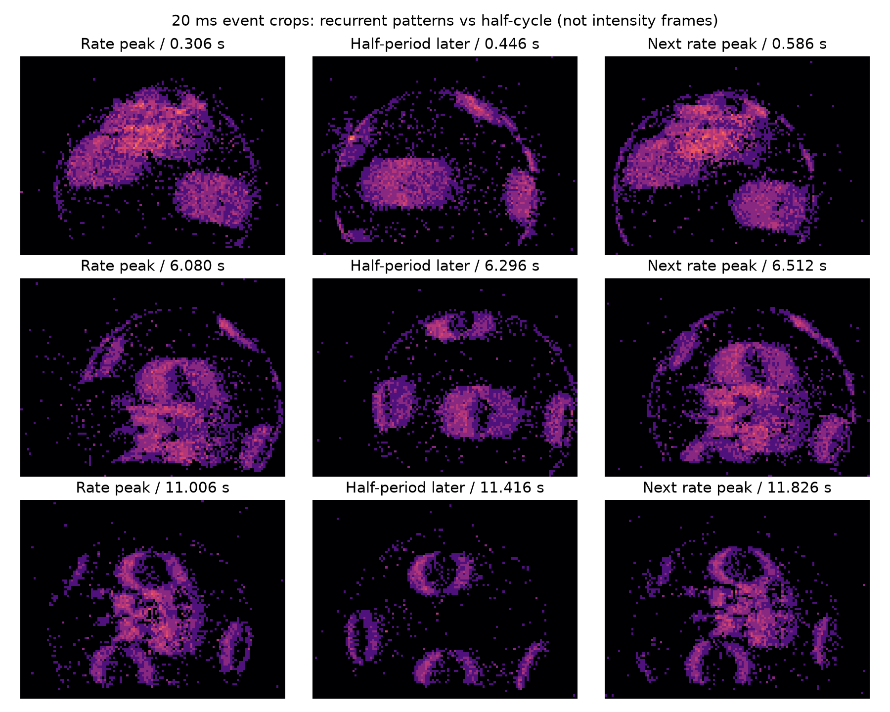
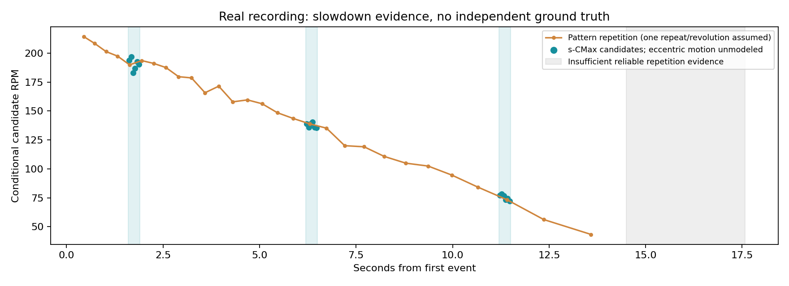
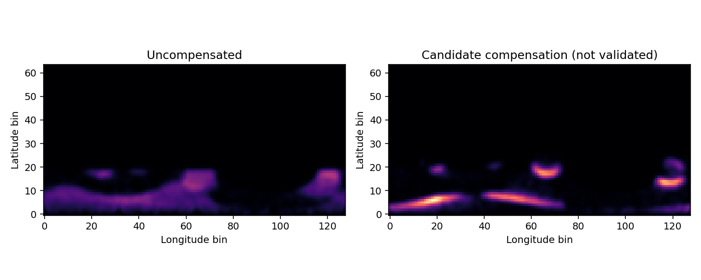

# DVSLume-G1 乒乓球旋转估计阶段一组会汇报

汇报日期：2026年10月30日　｜　实验录制：2026年10月29日　｜　代码基线：6590a30

## 一 本阶段目标与主要结论

本阶段研究固定相机下，利用事件相机观测乒乓球表面标记，离线估计转速和三维角速度的可行性。实验中将乒乓球手动固定在小圆盘上，拨动后使其自由减速。当前重点是验证真实事件处理链路和算法行为，而非飞行球跟踪或实时控制。

真实录像采用两种方法交叉比较：**事件周期法**估计图案重复频率；**球面对比度最大化 s-CMax**通过三维运动补偿估计角速度。三个片段的候选转速约为 **192、137、76 RPM**，两种方法相差 **0.31–1.41 RPM，约0.16%–1.91%**，均支持逐渐减速的解释。

这一结果是可行性证据，不是精度结论。两种方法共享同一事件流，没有独立转速真值；实验存在偏心摆动和下部遮挡，三维旋转轴尚不能作为可靠测量结果。

### 实验数据

| 项目 | 本次设置或结果 |
|---|---|
| 相机与解码 | DVSLume-G1；官方 DVSense SDK 1.3.0；EVT3.0 RAW |
| 主分析录像 | DSP03F100025_20261029_222403.raw |
| 分辨率与时长 | 1280 × 720；17.579495秒 |
| 事件数量 | 6,020,744；ON 1,965,757；OFF 4,054,987 |
| 数据检查 | 时间戳倒序0；非法坐标／极性0；复制前后SHA256一致 |
| 球体成像 | 半径约48像素；下部约y=242–245处截断或遮挡 |
| 独立参考 | 无编码器／转速计真值，无标定旋转轴真值 |

### 两种算法各自回答什么问题

| 方法 | 核心观测 | 输出 | 关键假设 |
|---|---|---|---|
| 事件周期法 | 图案或事件率多久重复一次 | 条件性RPM候选 | 一次重复对应一圈，且不是频闪或倍频 |
| 球面 s-CMax | 哪个角速度使补偿后事件最聚集 | ω、RPM、归一化轴候选 | 球面几何正确，短窗内球心和角速度近似不变 |

代码另有局部法向光流模块，但尚未形成可用于本次真实录像对比的可靠结果，也未作为 s-CMax 初值。因此本次汇报比较的是上述两种方法。

<!-- PAGEBREAK -->

## 二 事件周期法原理

### 从表面标记到重复周期

事件相机输出亮度变化事件 eᵢ=(uᵢ,vᵢ,tᵢ,pᵢ)，而非普通强度图像。球体旋转时，非对称标记在视野中的位置和边缘运动周期性重复，因此球区事件率和空间事件分布可能呈现重复结构。

本次真实数据首先在球区 x∈[500,620)、y∈[160,250) 内，以2毫秒为间隔统计事件数。对事件率做标准差为50毫秒的高斯平滑，寻找突出峰；相邻峰之间的时间间隔作为候选重复周期：

```text
q[k] = 第k个2ms时间格内的球区事件数 / 0.002s
Tⱼ = t_peak,j+1 − t_peak,j
fⱼ = 1 / Tⱼ
RPM_period = 60 / Tⱼ       （假设一次重复对应一圈）
```

峰提取采用最低突出度16,000 events/s、峰间最小距离180毫秒。这些是本次慢转录像的工程参数；最小峰间距会限制可识别的重复频率，不能直接套用于高速旋转实验。

### 如何避免把噪声周期当成旋转

将球区划分为12×9空间网格，分别统计ON／OFF事件，形成216维空间特征；归一化后在约2秒滑动片段内计算自相关，检查事件图案是否重复。同时选择等面积背景区 x∈[350,470)、y∈[160,250) 作对照。

本次球区低频重复信号明显强于背景；峰时刻与下一峰的事件图案较相似，而半周期图案不同。这支持重复来自球上标记运动。自相关、事件率峰间隔和图案检查是同一周期方法的辅助证据，不是三个独立转速真值。



图1　每张图累计20毫秒事件。比较峰、半周期与下一峰的图案，辅助辨别完整重复周期；这不是普通曝光照片。

### 主要局限

若一圈出现m次相似图案，直接用重复频率换算的RPM可能是真实值的m倍；漏峰则可能低估。局部频谱最强峰在本次数据中常为完整重复频率的3–6倍，因此没有直接采用最大FFT峰作为转速。周期法也无法恢复旋转轴。

<!-- PAGEBREAK -->

## 三 球面 s-CMax 原理

### 将像素事件提升到三维球面

球心为(cₓ,cᵧ)，图像半径为r。采用正交投影近似，将球内事件映射到单位球面。相机坐标定义为x向右、y向下、z远离相机，可见半球取负z：

```text
xᵢ = (uᵢ − cₓ) / r
yᵢ = (vᵢ − cᵧ) / r
zᵢ = −√(1 − xᵢ² − yᵢ²)
Xᵢ = [xᵢ, yᵢ, zᵢ]ᵀ
```

这一步利用球体曲面几何，不能用二维图像平面旋转替代。本次使用球半径的0.8倍作为有效内部区域，并额外排除y≥240的遮挡部分。每个选中片段单独固定ROI，未对偏心平移做运动补偿。

### 用候选角速度将事件补偿到同一时刻

设短时间窗内角速度ω=[ωₓ,ωᵧ,ω_z]近似恒定。先对整数微秒时间戳作差，再换算秒；将各时刻的球面点反向旋转到参考时刻：

```text
Δtᵢ = (tᵢ − t_ref) × 10⁻⁶             （t以微秒表示）
X′ᵢ(ω) = R(−ω Δtᵢ) Xᵢ                （ω单位rad/s）
```

R为三维旋转矩阵。若候选运动接近真实运动，同一标记边缘在不同时刻产生的事件轨迹应更集中；错误运动通常留下拖尾。参考时刻取窗口首末有效事件的中点。

### 构建球面事件图并优化

将补偿点映射为纬度θ和经度φ，通过双线性累积构建 Image of Warped Events，简称IWE；再对事件图方差进行优化：

```text
θᵢ = asin(z′ᵢ)；φᵢ = atan2(y′ᵢ, x′ᵢ)
ω_best = argmax_ω Var(IWE(ω) / N)
RPM = 60 norm(ω_best) / (2π)；axis = ω_best / norm(ω_best)
```

N为当前优化使用的事件数；所有候选使用同一事件子集，所以除以N不改变该窗口内的最优解。IWE累积非负事件计数，不将ON／OFF相互抵消。经度周期连接，平滑使用5×5高斯核、σ=1。

| 项目 | 本次真实数据实现 |
|---|---|
| 分析窗口 | 50毫秒；每段0.3秒，共6个连续窗口 |
| IWE分辨率 | 64×128；每窗最多使用5000个事件 |
| 初值与搜索 | 70个定向轴候选；大小网格搜索；最多8个分离初值 |
| 局部优化 | SciPy Nelder–Mead；转速搜索上限600 RPM |

核心球面映射、反向旋转和方差目标参考Sony论文§3.3。多轴网格初值、ROI、阈值和窗口长度属于工程选择；当前没有接入论文的光流初始化，不能称为完整复现Sony流程。

<!-- PAGEBREAK -->

## 四 真实录像结果与两种方法的差异

### 减速趋势与选取的片段

从主录像选取1.6–1.9秒、6.2–6.5秒、11.2–11.5秒，分别观察较快、中速和较慢阶段。时间均相对首事件197754251微秒。未施加单调减速拟合约束。



图2　橙色为图案周期候选，青色为s-CMax短窗候选。灰区表示14.5秒后缺少可靠重复证据；没有直接填0 RPM。

| 片段 | s-CMax RPM | 周期法RPM | 有符号差值RPM | 相对差值 |
|---|---:|---:|---:|---:|
| 1.6–1.9秒 | 191.55 | 191.24 | +0.31 | +0.16% |
| 6.2–6.5秒 | 137.48 | 138.43 | −0.94 | −0.68% |
| 11.2–11.5秒 | 75.54 | 74.13 | +1.41 | +1.91% |

```text
差值 = RPM_s-CMax − RPM_period
相对差值 = 差值 / RPM_period × 100%
```

s-CMax列为片段内六个50毫秒窗口的中位数；周期法列为片段中点的候选转速插值。两者观测方式和时间支撑不同，因此这是片段级对比，不是严格逐窗对齐的误差实验。表格基于未四舍五入数值计算差值。

### 三维角速度输出示例

下表为各片段第一个50毫秒窗口的实际输出，不是上表RPM中位数对应的向量。

| 窗口起点 | ω候选 rad/s | 该窗RPM |
|---|---|---:|
| 1.60秒 | [−0.709, 19.709, −4.733] | 193.68 |
| 6.20秒 | [0.003, 14.059, −3.752] | 138.95 |
| 11.20秒 | [0.028, 8.007, −1.151] | 77.25 |

角速度主分量沿图像+y方向，速度模长随时间减小。但球心漂移会被旋转模型部分吸收，可能影响分量和轴向。以上ω用于诊断，不作为已经标定的真实三维角速度。

### 结果能够支持的结论

两种方法在三个选中片段的差异不超过1.42 RPM、2%，并且观察到一致减速趋势，支持真实事件中存在可利用的球体运动信息。**“两法相差约2%以内”不等于“测量误差小于2%”**：目前没有独立转速参考，倍频和共同系统偏差尚未完全排除。

<!-- PAGEBREAK -->

## 五 运动补偿与相邻窗口稳定性

### 补偿后是否更聚集



图3　中段首个50毫秒窗，左右采用同一色标。补偿后条带变窄、局部边缘更集中；这是与候选运动一致的证据，不等于真实转速误差更小。

三段优化子集的方差增益分别约46%–110%、62%–86%、67%–85%。每窗候选之间使用相同事件数；图中展示的是全量有效事件，因此不能把显示图的方差直接等同保存的优化子集目标值。经纬网格的极区畸变，也可能影响对比度指标。

### 转速较平稳不代表三维轴稳定

| 片段 | RPM标准差 | RPM变异系数 | 最大相邻轴夹角 |
|---|---:|---:|---:|
| 1.6–1.9秒 | 4.61 | 2.42% | 19.95° |
| 6.2–6.5秒 | 1.87 | 1.36% | 7.38° |
| 11.2–11.5秒 | 2.20 | 2.92% | 4.18° |

标准差包含真实减速趋势，不能作为测量误差。轴夹角使用有向向量的acos(aₖ·aₖ₋₁)，不取点积绝对值。早段相邻轴最大变化近20°，说明当前三维稳定性还不能验收通过。

### 几何误差与有效性解释

全片球心水平拟合位置约539–573像素，摆动约34像素，相比约48像素半径不可忽略。三个选中片段的球心拟合跨度约2.2、5.0、10.4像素；后两者还混有轮廓拟合误差。分别扰动球心x、y或半径±2像素时，单窗候选RPM范围如下：

| 片段 | ROI扰动后的RPM范围 |
|---|---:|
| 早段 | 173.4–193.7 |
| 中段 | 132.3–145.9 |
| 晚段 | 72.2–81.5 |

这只是每段一个窗口的敏感性检查，不是置信区间；晚段实际几何不确定可能超过±2像素。18个窗口均通过计算门限，但结果全部保留physics_validated=false。真实分析专用脚本没有经过通用CLI的相邻窗拒绝流程，不能将“18/18计算有效”解释为整段三维测量可靠。

<!-- PAGEBREAK -->

## 六 阶段一判断与下一步实验

### 阶段一验收判断

| 验收内容 | 当前状态 |
|---|---|
| 数据链路与事件可见性 | 真实RAW解析、校验、回放可用；可见球面标记事件 |
| 运动补偿与RPM候选 | 已展示聚集改善，两个方法支持一致减速趋势 |
| 三维稳定性 | 未通过；存在偏心、遮挡、ROI误差和早段轴跳变 |
| 独立真值精度 | 未通过；无法计算真实RPM或轴误差 |
| 第三方完整复现 | 有缺口；外部RAW适配器与辅助程序未完整交付 |

30项软件测试支持测试覆盖范围内的实现正确性，不证明真实场景精度。基础球面公式目前未发现明确算术错误，但多初值搜索和优化收敛也不能证明全局最优或旋转轴可观测。

现有成果可定位为“真实事件球旋转估计的初步可行性验证”。形成正式定量实验还需要以下工作：

1. **建立独立真值。** 尽量使球心与圆盘轴同轴，减少遮挡；用编码器或转速计测RPM，并标定电机轴在相机坐标系中的方向。覆盖不同转速、轴向、正反转，每种条件至少三次重复。
2. **从选段展示转向全记录评估。** 固定选窗规则，报告逐窗RPM绝对／相对误差、有向轴误差、有效率、失败原因和运行时间；区分真实减速与估计抖动。加入静止、图案不可见、频闪和偏心等负对照。
3. **完成方法比较与复现。** 在一致观测时间和数据范围内比较两法；检查窗口长度、ROI扰动和初值数量的影响。交付版本化RAW适配器／辅助程序、数据获取与校验步骤，并在干净环境从RAW重跑报告。

### 建议组会讨论的问题

- 下一轮优先改进同轴固定装置，还是先进行有编码器参考的转速实验？
- 三维轴允许多大的相邻变化，哪些条件下应直接拒绝结果？
- 先以RPM为主要量化目标、轴向作为探索结果，是否更适合当前数据条件？

### 参考资料与结果入口

[1] Sony，Event-based Gaze Control System for Accurate Real-time Spin Estimation in Professional Ball Games，§3.3、§4.2。https://arxiv.org/html/2606.26780v2

[2] Gossard等，Table Tennis Ball Spin Estimation with an Event Camera，2024。https://arxiv.org/abs/2404.09870

[3] Sony Ace，Approximate Python Code。https://sonyresearch.github.io/ace_public/pseudo_code/　公开伪代码仅作参考，公式以正式论文为准。

[4] DVSense官方RAW读取文档。https://sdk.dvsense.com/zh/html/file_zh.html

本次数据与结果：g1_spin/outputs/real_222403/report.md；selected/{early,middle,late}/result.json；selected/candidate_comparison.png；periodicity/cycle_candidates.csv。三段原始录像的路径与SHA256见g1_spin/data/archive_manifest.json。

**汇报结论：已经看到真实事件中的旋转和减速信号，并获得两种方法接近的RPM候选；下一阶段的核心是独立真值与三维稳定性验证，而不是继续增加功能。**
