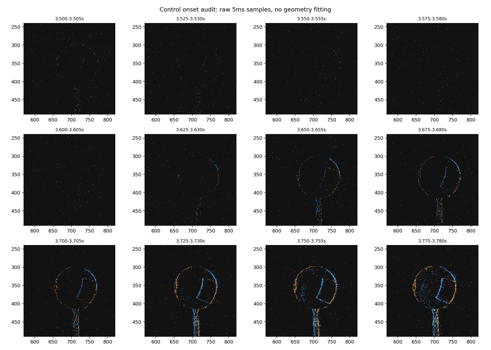
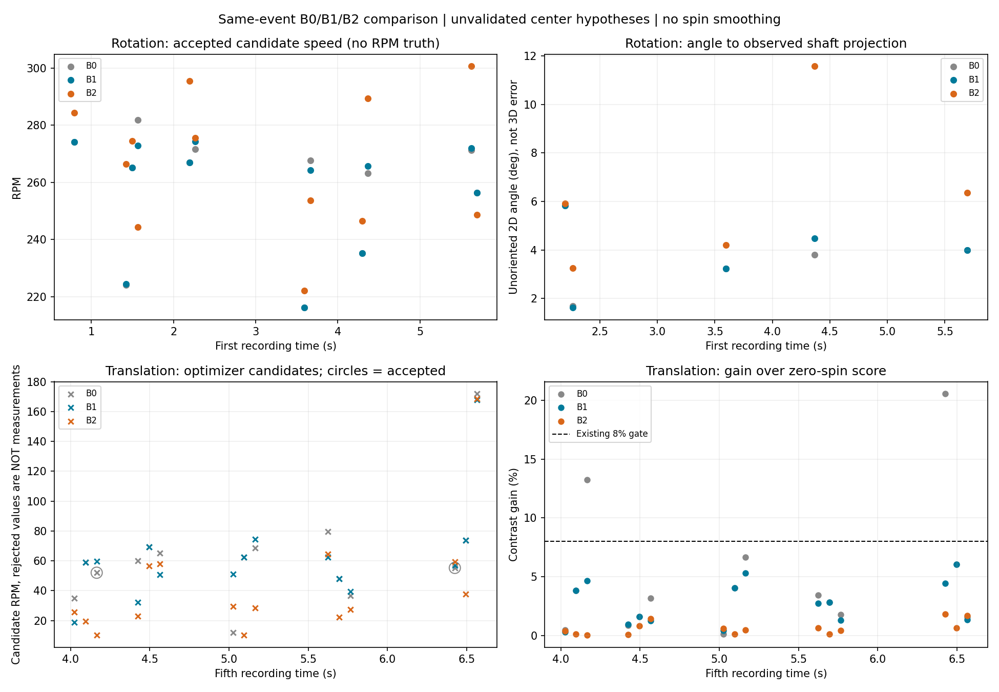
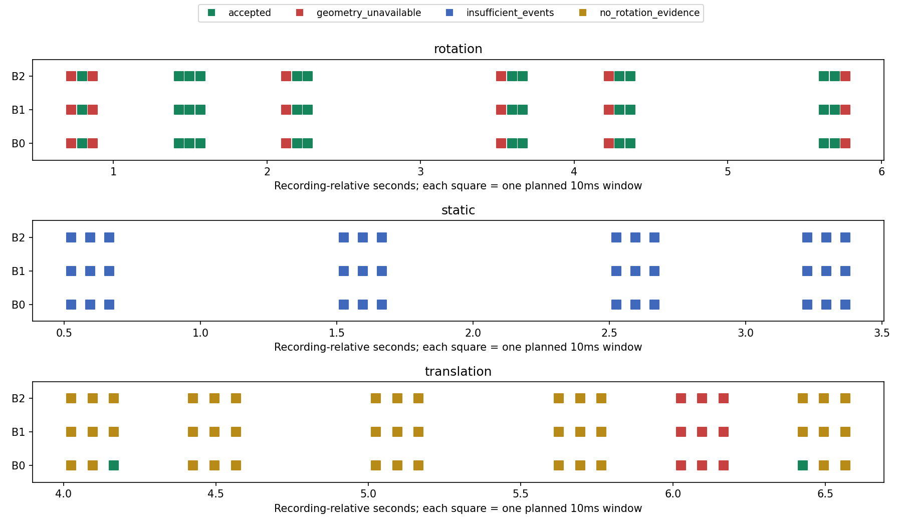
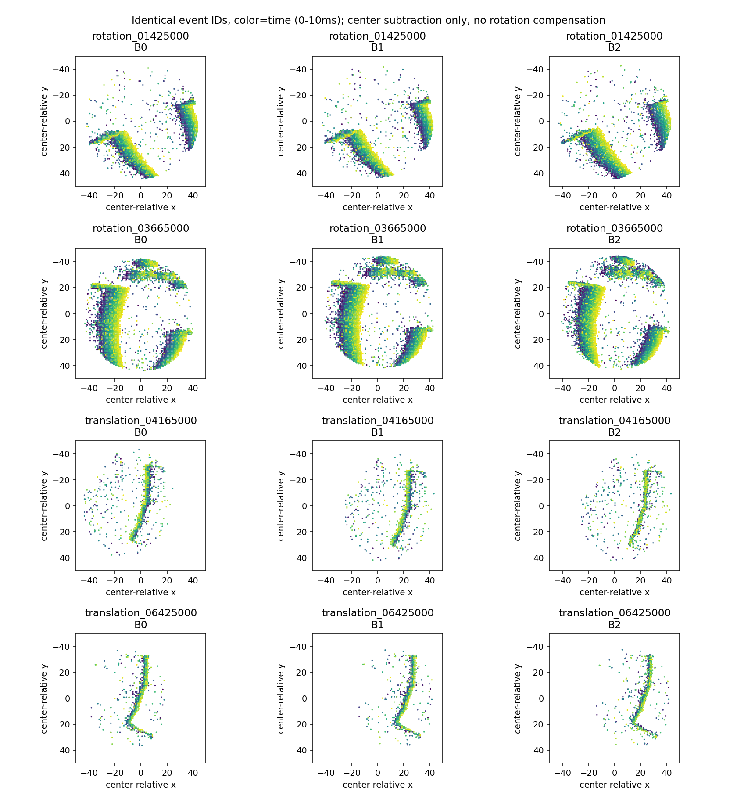
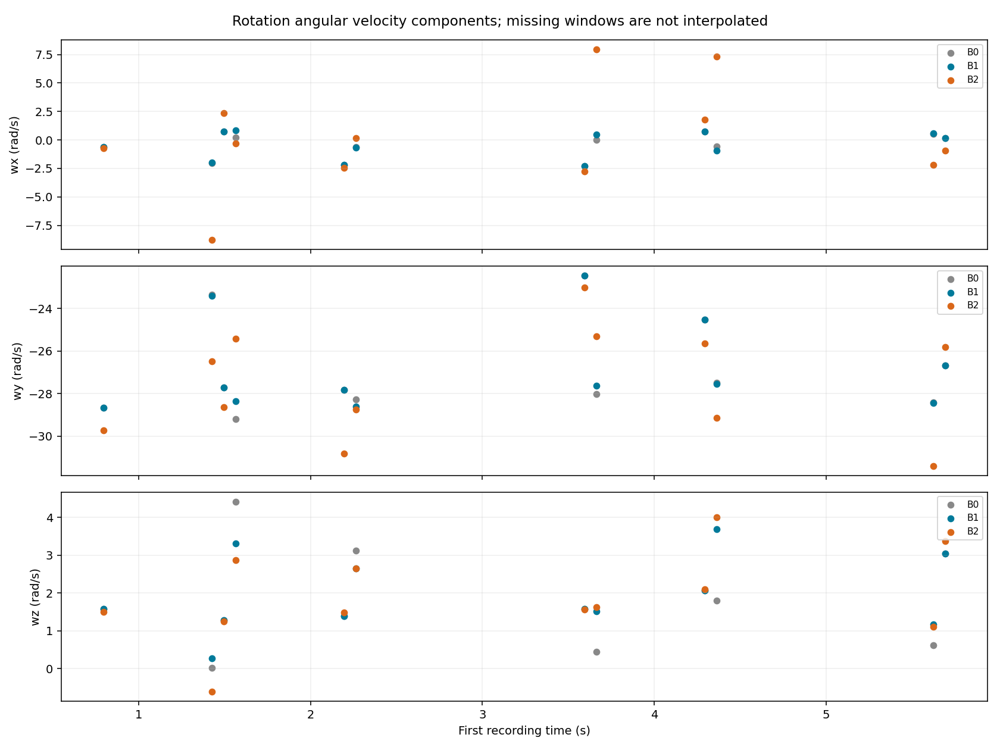

# 第一段＋第五段：固定轴正例与静止／平移负例，2026-11-06

第一轮已完成。现有s-CMax在有几何支持的第一段窗口中恢复了近竖直的有向轴候选；第五段显示片段固定球心会产生非零误报，逐窗更新球心后本轮未见有效旋转输出。**逐事件补偿没有同时改善正例：若直接使用当前轮廓候选轨迹，部分轴反而更分散。当前应保留B1作基线，优先核查球心轨迹的窗内变化，再接光流初始化。**

这不是三维轴或转速精度验收，也不是完整ACE复现。几何由同一事件流估计，没有独立球心、轴或RPM真值；所有结果标记 `hypothesis_only=true, physics_validated=false`。第五段“无自转”来自用户操作说明，没有独立测量排除微小手持姿态变化。

## 执行范围与数据纪律

- 使用已备份到Mac的完整RAW官方解码记录；全程无需SSH。
- 冻结 `spherical_cmax.py`、光流、事件读取、CLI及平移数学模块，原文件和本轮输入前后hash一致。生产源码、IWE、门限、初始化和相机设置未修改。
- **先审阅几何、再冻结协议、最后求解**。取16个200ms片段，每片段预定3个互不重叠10ms窗，共48窗（仅0.48秒抽样事件时间）。不是整段逐窗穷尽分析；报告的比例是预定样本比例，不是全部录像可用率。
- 开发与评价用不同连续片段，期间未依据旋转结果调参。仍来自同一录制，不能当独立重复实验或泛化测试。
- B0在每个200ms片段固定球心；B1每个10ms窗更新一次球心；B2按事件时间使用插值球心。三者固定r=60px，同窗共享事件ID、时间、顺序、极性与一次下采样。没有旋转平滑、历史值填充或按结果重选窗口。
- 保留中心±2px、半径58px的安全余量后，共同内区半径为44.4px。相对B2原0.8r支持，公共保留比例自转最小/中位63.7%/84.9%，平移29.4%/74.7%；困难边缘被排除，结论不覆盖被排除事件。
- 本轮直接调用冻结的独立 `estimate()`，不调用CLI中的相邻窗口拒绝逻辑。球心参考时刻为窗口中点；估计器内部旋转参考仍按实际保留事件首尾中点，逐窗值已记录，未改原算法。
- 生成216条结果记录：144条主对照和72条预定单因素扰动。包含几何失败和不足事件记录，不等同于216次完整数值优化。

完整设定见 [冻结协议](protocol.md)、[环境及输入hash](environment.json)、[全部窗口输入审计](window_audit.csv)。

## 第五段状态边界

3.600–3.605秒的5ms图仍主要为稀疏事件；3.625–3.630秒开始出现明显轮廓；3.650秒后轮廓更强。本轮观察到的起动区间约为 **3.60–3.65秒**，不将其当作精确机械起动时刻。全部3.5–3.9秒过渡区未纳入稳定状态比较。

静止分析窗在0.525–3.375秒内，平移分析窗在4.025–6.575秒内。后面的更大幅移动暂未进入本轮主结果。

## 主结果

|条件|预定窗口|有可计算输入|B0有效非零输出|B1有效非零输出|B2有效非零输出|
|---|---:|---:|---:|---:|---:|
|第一段自转|18|12|12|12|12|
|第五段静止|12|0个达到最低事件数|0|0|0|
|第五段平移|18|15|2|0|0|

自转缺失6窗、平移缺失3窗，均因为几何插值缺口超过30ms，三版整组保留 `geometry_unavailable`。不是旋转估计失败后剔除。

静止的5ms图无法可靠检测圆心。只用人工固定位置先验(714,355)px诊断误报，三版中心相同、不据此评判补偿。每个10ms窗公共内区仅6–18个事件，12窗全部返回 `insufficient_events`。**这说明在所选静止样本中没有输出虚假轴，不是准确测得0 RPM。** summary.json中的geometry_available对这些窗仅表示有人工位置先验，并非检测成功。

### 自转：有方向证据，逐事件补偿尚未带来一致收益

|指标（12个配对窗口）|B0|B1|B2|
|---|---:|---:|---:|
|候选RPM中位数|266.0|265.4|270.5|
|有向轴相对本方法均值的夹角中位数|3.10°|2.89°|4.71°|
|有向轴相对本方法均值的最大夹角|5.35°|5.22°|19.29°|

候选轴主要沿相机−y（相机x向右、y向下、z远离相机），与“竖直轴”的定性预期一致。没有把已知轴提供给优化器；方向符号与用户说明的正反转对应还需第四段后续验证。

这些RPM未由转速计验证，角度是离散程度，不是相对真实三维轴的误差。B1为后续比较基线的理由是本轮正负例联合表现，而不是已证明其绝对正确。

对5个能独立从球外钻杆事件拟合出可靠直线投影的窗口，B1估计轴投影与钻杆投影无向夹角中位数3.99°、最大5.84°；B2对应5.92°、11.58°。这里只是二维投影一致性，不能写成三维轴精度。其他窗口缺少足够钻杆线支持，保留不适用。拟合记录见 [shaft_projection.csv](shaft_projection.csv)，只用于评价，没有进入旋转估计。

### 平移：降低了误报，但不能声称已经测准零旋转

在15个可计算的平移窗中，B0有2个有效非零输出（按用户无自转标签作为误报）：4.165秒约52.1 RPM、6.425秒约55.3 RPM；分别落在开发与评价片段。其余13个B0窗没有足够旋转证据。

B1和B2在相同15窗全部返回 `no_rotation_evidence`，不是因事件数不足而无效。B2的旋转相对零候选的对比度增益中位数约0.46%，B1约2.73%，均低于未改动的8%工程门限；这支持“不应输出有把握的非零旋转”的判断，不能转化为统计意义的零转速置信区间。

|全部15个优化候选，仅作诊断|B0|B1|B2|
|---|---:|---:|---:|
|候选RPM中位数|60.1|58.9|28.4|
|候选RPM P95|107.4|102.6|95.9|

上述包含被拒绝候选，**不是有效残余转速测量**。B2仍有约168.6 RPM的被拒绝候选，因此不能宣称已恢复稳定、接近零的速度。现阶段没有任何“被接受的近零测量”类别；不得将无效填为零。B1/B2在平移段的有效旋转测量覆盖率为0/15，同时保留其全部拒绝诊断。

## 几何敏感性与竞争轴

预定6个敏感性窗，每个对B2做cx±1/±2、cy±1/±2、r±1/±2像素的12次单因素扰动。第五段6.095秒窗因为几何缺口，12种扰动均保留未运行，未换窗。

第一段三个可计算敏感性窗的12种扰动全部仍输出有效候选：

|窗口起点|相对B2最大有向轴差|最大RPM差|
|---|---:|---:|
|1.495 s|1.95°|14.68|
|3.595 s|3.95°|12.78|
|5.695 s|2.87°|10.56|

第五段4.095和5.095秒的扰动没有变成有效旋转输出。表中差异只表示固定几何偏置下的局部敏感性；**没有验证球心速度误差，也没有验证整个录像的几何精度**。详情见 [sensitivity.csv](sensitivity.csv)。

B2相对B1在第一段1.425、3.665、4.365秒的轴差分别约13.6°、16.4°、15.9°；对应10ms事件跨度内球心候选的纵向变化约+3.44、−3.54、−3.86px。它们可能包含实际振动、轮廓拟合误差和名义时间偏差；没有外部中心真值，不能直接断言全部是检测抖动。

然而，在相同几何输入下，自转各窗得分接近（最优的98%以上）的非微小运动候选，多初值轴间最大差：B0约0.17°、B1约0.23°、B2约0.82°。**本轮没有发现自转主结果被多个得分接近、方向相距很远的已找到局部解主导。** 这不证明全局唯一，但不支持优先用光流初始化掩盖球心轨迹问题。平移的低增益候选仍存在约50°的方向歧义，且被原门限拒绝。

## 验证与实际边界

- 39个有输入的窗口，用独立整文件布尔时间筛选和分段插值公式重建，事件ID、公共掩膜、坐标、极性、时间一致；球心计算最大差1.14e−13px。
- 去掉记录竞争候选的包装器，独立重跑一个真实窗口，整个估计器返回结果完全相同。
- 已知人工坐标平移后再消去，恢复误差为0；只验证代数，不是DVS物理仿真。
- 101个受保护源码／归档／协议文件hash未变，生产源码hash另行确认未变。
- 既有几何／旋转测试11项通过。两段几何叠加视频重新解码后帧数与尺寸一致。
- 自转每次估计的中位耗时约0.75–0.78秒，平移约0.20–0.21秒；不含几何提取和全部报告工作，不是端到端实时性能。

见 [verification.json](verification.json)、[视频校验](video_verification.json)、[测试记录](tests.txt)。

## 后续建议

先保留B1，核查上述三个窗的短时球心变化，重点分离轮廓来源、几何时间含义与窗内速度；不直接把B2设为默认，也不以旋转分数挑选中心。再用已冻结的设置扩展到第二段、第三段和第四段前部，检查深度轴、斜轴与反转关系。当前发现足够指导下一步，但本轮未执行这些扩展，也未接光流。

此轮未解决：自动几何缺测、球心真值、零转速量化、完整三维轴精度、光流初始化和真实实时处理。五段录像仍完整保存在本地，无需补录才能继续这些诊断。

## 重放入口

- [逐窗结果CSV](results.csv)、[完整结果与所有优化候选JSONL](results.jsonl)、[分状态／开发评价汇总](summary.json)、[竞争轴审计](candidate_ambiguity.csv)。
- [第一段几何叠加视频](rotation_geometry_preview.mp4)、[第五段几何叠加视频](control_geometry_preview.mp4)。视频每20ms展示5ms事件，50fps，仅采样预览；原始数据没有抽样丢弃。
- `windows/`保存每个可计算窗口的事件ID、坐标、极性、相对时间和B0/B1/B2球心。缺失窗口在审计表中，未伪造事件文件。
- 脚本依次为 `explore.py`、`geometry.py`、`run.py prepare`、`run.py optimize`、`verify.py`、`summarize.py`。使用项目已有 `g1_spin/.venv/bin/python`。优化入口拒绝覆盖已有results.jsonl；如需新实验应建立新输出目录并保留本轮。
