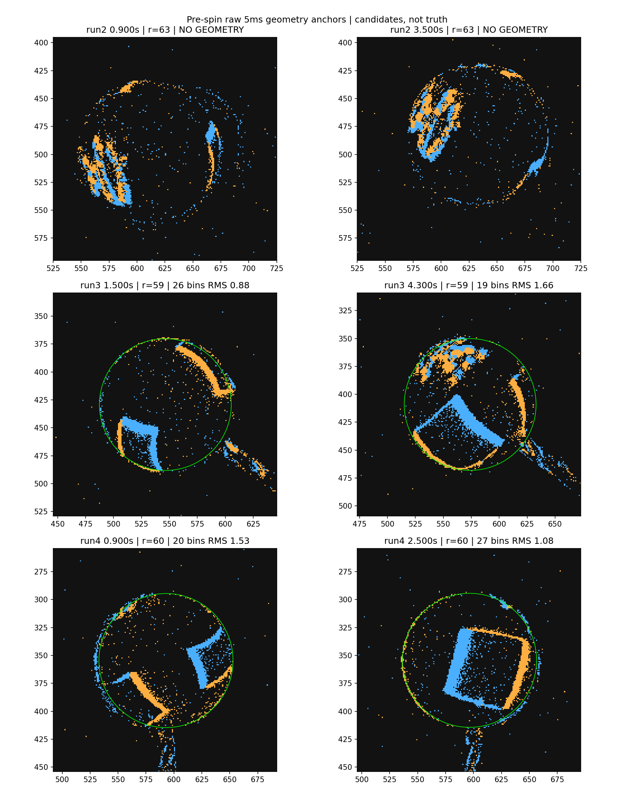
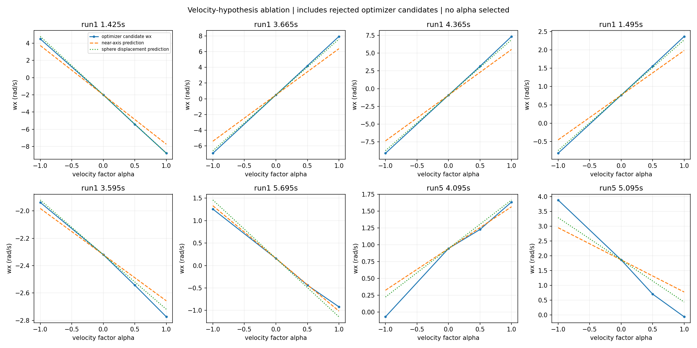
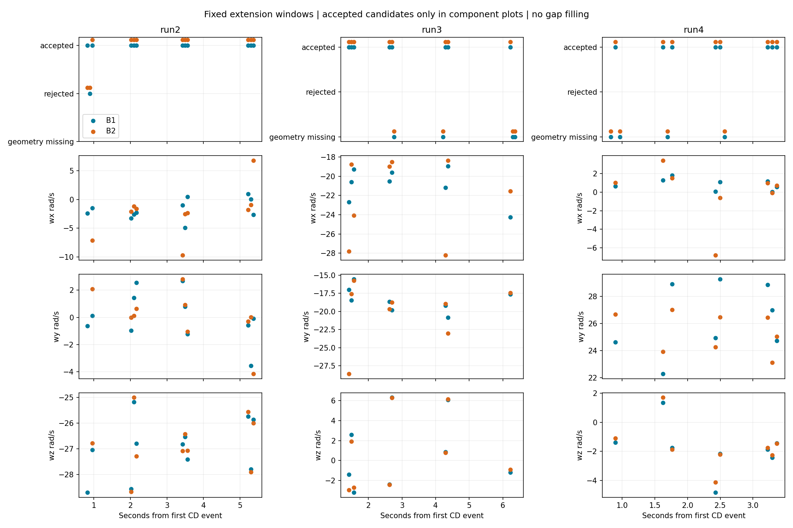

# 阶段2：插值修正、速度假设消融与三方向扩展

阶段2固定的 **36个扩展窗、8个速度诊断窗、2个过拒重放窗均已完成，共110条记录**，没有扩窗或降门限。新逐查询插值恢复两个原来过拒的run1窗；速度消融表明旧B2与B1的差异与球心速度假设存在可预测的球面运动耦合。run2出现以相机z分量为主的候选，run3候选与可见斜杆二维投影大体相容，run4与run1呈有向反转。**B1继续保留为暂定基线；没有根据这些输出选择alpha或更新生产默认。**

方案由GPT-6 Astra（xhigh）审阅，GPT-6.1 Sol（high）执行；本报告交Astra作阶段2结果审核。全部结果是 `hypothesis_only=true, physics_validated=false`。无独立球心、三维轴或RPM真值；可用率仅针对预定采样窗，不能外推到完整录制或独立重复实验。

## 协议与数据纪律

- 新目录独立保存，原phase1的48窗、216行及分母均未改写。两个恢复窗作为补充单列。生产源码、5个完整RAW、完整官方解码输入及旧实验文件共231项hash前后不变。
- [协议](protocol.md)先落盘，再提取并审阅六个几何锚点；[审阅记录](geometry_review.json)、[配置](config.json)、324格点候选及脚本等在求旋转前冻结，hash见[freeze.json](freeze.json)。不是先看轴再调圆。
- run2/run3/run4固定r=63/59/60px，来自原QC的图像量级。run2没有可靠外露杆，不强加向下排除扇区；run3朝右下外杆排除5–65°，run4向下杆排除60–120°。
- 5ms、10ms格点、36角区、15支持角区、RMS≤2.5px等拟合门限冻结。324格点中接受96/108、69/108、69/108；其余缺测保留。每个200ms块单独从固定seed开始，不跨块填值。
- 扩展B1/B2使用两者0.8r共同内区、相同ID/时间/极性/顺序，一次确定性下采样≤5000。相对B2原支持，公共保留比例最小/中位：run2 96.1%/99.3%，run3 96.1%/99.4%，run4 99.5%/99.9%。本阶段无半径扰动，未额外缩到phase1的44.4px；恢复窗仍用原44.4px交集。跨阶段RPM或可用率不宜直接合并。
- 速度消融直接复用phase1保存的ID，不加新掩膜或再下采样。`c_alpha=B1+alpha*(B2-B1)`，alpha=-1/0/0.5/1，r60，其他全部相同。
- 冻结s-CMax仍为maxRPM3500、initial=None、原IWE/多轴网格/多初值Nelder–Mead与工程门限。未接光流、未加平滑、未改估计器，仅外部记录竞争候选。

run2的0.900/3.500秒原始外弧可见，但该精确5ms锚点拟合均未通过，原样留空；run3/run4四个锚点候选与可见弧大体吻合。锚点是独立审阅快门；求解使用冻结10ms格点轨迹，因此run2精确锚点失败不等同于其相邻格点不能为估计窗提供插值支持。

## 逐查询插值修正与两个补充重放

旧`centers()`检查从查询最小值到最大值之间全部几何缺口。把窗首尾和200ms块锚点一并查询，会因为并不参与任何查询插值的中间缺口而拒绝窗口。新函数仅检查每个查询实际左右支点≤30ms，exact-knot直接取该观测；窗与B0锚点分别查询，不为未使用的间隔施加条件。

|run1补充窗起点|B0 RPM|B1 RPM|B2 RPM|状态|
|---|---:|---:|---:|---|
|0.725s|209.39|209.59|207.93|三者均有效候选|
|5.765s|217.91|214.50|230.60|三者均有效候选|

这修复的是新增实验的输入可用性判定，不代表物理精度提升，也不追溯改写旧报告。旧phase1的另外缺测窗未在本阶段追加求解。

## 速度假设消融

对8窗均保存从窗首−25ms至窗尾+25ms的完整60ms原始事件/ID到`diagnostics/*_raw_context.npz`，并绘制中心±25ms范围每5ms采样的1ms/5ms原始图、旧候选圆、角区支持、Hough半径及名义/事件中位时间，见[原始诊断JSON](raw_diagnostics.json)和`diagnostics/`八张完整图。图中`g`是实际旧候选观测时刻；快门中心落在两个旧格点之间时画最近候选，时间差保存在JSON，不能把叠图当成同一瞬时中心真值。

|run1异常窗|近轴预测Δwx|完整球面线性位移预测Δwx|实际A1−A0 Δwx|A0与A1候选轴差|
|---|---:|---:|---:|---:|
|1.425s|−5.73|−6.79|−6.78|13.59°|
|3.665s|+5.90|+7.12|+7.46|16.40°|
|4.365s|+6.44|+7.82|+8.27|15.93°|

角速度单位rad/s。近轴式为`Δwx≈−Δcy/(rΔt), Δwy≈+Δcx/(rΔt)`；完整预测用相同事件上`delta_omega × sphere_point * (t−t_ref)`拟合球心假设改变造成的三维球面位移，包含负z。它是同一输入的代数耦合预测，并非独立物理验证。完整omega、wy/wz、候选增益和所有alpha状态见[velocity_ablation.json](velocity_ablation.json)/[CSV](velocity_ablation.csv)。

三个异常窗wx随alpha基本线性且符号、尺度符合预测；三个run1对照窗A0/A1轴差为3.15°、0.98°、2.54°。24条run1消融候选均被原门限接受。这说明几何速度假设足以显著转动候选轴，不能因此断言B2的中心一定错误、A0就是真值或从最小离散选择alpha。

原始5ms两侧外弧提供了有限交叉检查：1.425s两侧单独环内拟合的cy变化约+0.83/+0.55px，均小于旧轨迹约+3.44px；3.665s对应约−0.36/−2.79px，与旧轨迹约−3.54px并不完全一致；4.365s比较末端旧候选缺测，双侧诊断不可用，未补值。单侧拟合仍以旧圆附近薄环选点、角区稀疏且含运动纹理，不能作为独立中心估计。外杆在部分5ms图可拟合出线，其支撑、斜率和固定全局y=450px处x位置保存在原始诊断中；直线仅约束二维投影/横向位置，沿杆方向位移仍不确定。

1ms图的外弧支撑更稀疏，5ms图中纹理接近外弧且Hough半径随快门变化，不能从这些图唯一分离真实振动、轮廓拟合偏差或名义时间误差。旧候选5ms附近105px ROI的事件时间中位数相对名义时刻，在三异常窗邻域约为[−0.110,+0.069]、[−0.0345,+0.040]、[−0.018,+0.052]ms；这个未加权ROI时间代理本身未显示毫秒级整体偏移，不能排除角区依赖的有效时间偏差。

run5两个平移窗的alpha=-1均产生被接受非零候选，约102.83/134.95RPM；alpha=0/0.5/1均返回`no_rotation_evidence`。反向补偿会放大非零候选，支持平移与球面旋转的耦合诊断；没有将被拒绝的19.69/10.32RPM等A1候选称为有效残余旋转，也没有把拒绝填零。

## run2/run3/run4的36个固定窗

|条件|预定窗|有几何输入|B1有效|B2有效|开发B1/B2|评价B1/B2|
|---|---:|---:|---:|---:|---:|---:|
|run2 朝相机|12|12|11|10|5/6、4/6|6/6、6/6|
|run3 斜杆|12|8|8|8|5/6、5/6|3/6、3/6|
|run4 反转前段|12|8|8|8|3/6、3/6|5/6、5/6|

run3四个、run4四个几何失败窗在所有表和图中保留。run2的0.895s两版均因增益低于原8%门限拒绝（7.970%/7.631%），0.825s的B2也因7.282%增益拒绝；未因“接近门限”改变规则。候选RPM与失败状态均保留。

|有效候选摘要|run2 B1/B2|run3 B1/B2|run4 B1/B2|
|---|---:|---:|---:|
|RPM中位数|258.0 / 260.4|271.9 / 270.4|250.7 / 248.5|
|B1与B2有向轴差中位/最大|6.07° / 22.04°|3.74° / 9.05°|0.87° / 15.64°|

RPM未由转速计验证；B1/B2比较只用两版都有效的10/8/8个配对窗，不把拒绝或缺测补零。开发评价来自同一录制的分离连续块，没有据此做参数选择。

run2的有效轴`|z|/||axis||`中位数为B1 0.9944、B2 0.9964，方向主要沿相机−z，符合“朝向相机”定性条件。该录制没有可靠外露杆投影，投影指标留空。它不是独立三维角误差测量。

run3的8个有几何窗均有外杆二维线支持，B1轴与杆投影无向夹角中位/最大5.47°/10.94°，B2为9.02°/14.71°。候选轴主要在图像左上方向，外杆朝右下，无向投影相容；但B1候选`|z|`中位仅0.0886，没有独立深度倾角可验收，不能声称已恢复用户“斜向相机”的准确三维倾角。

run4的8个B1/B2有效候选wy全部为正，而旧run1固定12窗B1的wy全部为负。对旧run1 B1平均有向轴，run4 B1夹角中位178.63°（范围172.06–179.12°），B2中位177.87°（162.64–178.96°），支持用户所述正反转的方向一致性；不要求两次RPM一致，也不能把条件标签当精确轴真值。run4仅5窗有合格外杆线，B1/B2投影差中位2.19°/2.98°，其余不适用留空。

全部原始10ms事件叠图：[run2](run2_geometry_evidence.png)、[run3](run3_geometry_evidence.png)、[run4](run4_geometry_evidence.png)。绿圆是B1几何候选，洋红线是窗内B2中心假设；白线是有支持的外杆投影候选；无几何窗不画假圆。图中不做旋转补偿。

## 自验证与交付

[verification.json](verification.json)已通过：46窗逐窗核查，其中38窗输入、8窗几何失败原因均由独立完整NPY布尔时间筛选和逐点插值重建；ID、公共掩膜、顺序、极性、时间一致。八段完整60ms上下文的事件与ID也逐一匹配归档。全部变体独立重建真实窗完整xyz并检查可见负z和单位模长，中心最大差1.14e−13px、xyz最大差3.00e−15。专门测试未使用中间长缺口可通过、实际跨>30ms拒绝、exact-knot不跨点。去候选记录器重放一个恢复窗B1，估计器字典完全一致。231项受保护文件hash未变。

旧phase1验证没有独立重建真实窗的负深度z，本阶段补齐；上述验证证明计算一致和输入未改，不证明球心或旋转物理准确。未重新运行旧216条结果，也未运行与新增工作无关的全量测试。

主要文件：[完整110行及竞争候选](results.jsonl)、[逐行CSV](results.csv)、[全部46窗输入审计](window_audit.json)、[逐窗球心/半径与实际插值支点的支持](window_geometry_support.json)、[分组统计](summary.json)、[B1/B2差异](paired_comparison.csv)、[外杆投影](shaft_projection.csv)、[反转检查](reversal.json)、[竞争轴审计](candidate_ambiguity.csv)、[全部输入来源hash](source_hashes.json)。`windows/`保留38个实际输入NPZ；无几何窗仅保留失败记录。

运行入口，均使用项目已有`g1_spin/.venv/bin/python`：`run.py geometry` → 原始锚点审阅并记录`geometry_review.json` → `run.py freeze` → `run.py prepare` → `run.py optimize` → `diagnostics.py` → `summarize.py` → `verify.py`。已有关键输出拒绝覆盖；要重放应复制本目录脚本及冻结输入到新的输出目录。所有采样/半径/角区/门限均在旋转前固定。

本阶段在既定46窗完成后结束。剩余的物理几何不确定性、三维倾角/RPM真值、稀疏静止输出及真实实时性未解决。下一阶段按已审阅有限路线进行G/A/S论文/工程初始化对照，再作五段汇总；本阶段未提前开展该工作。
