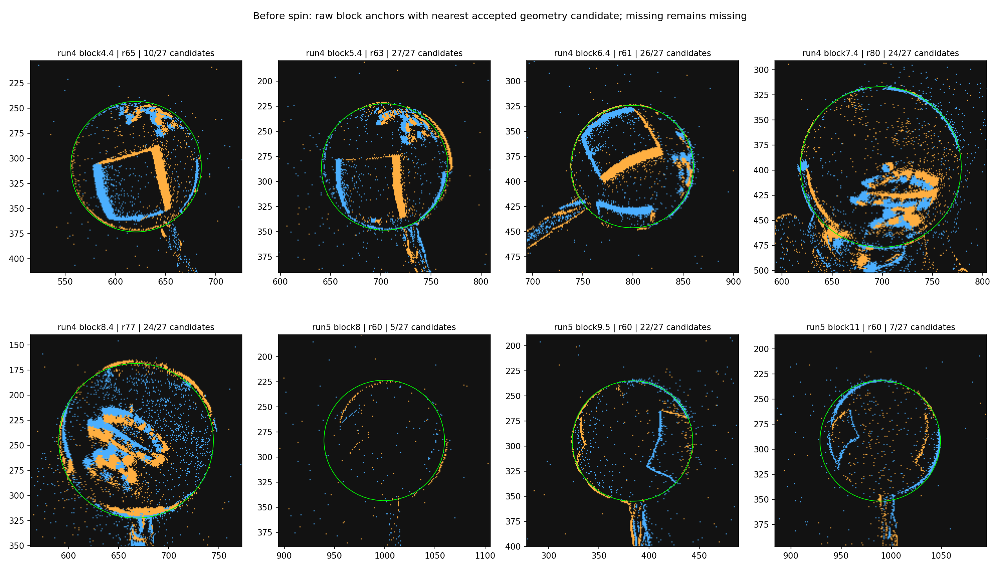
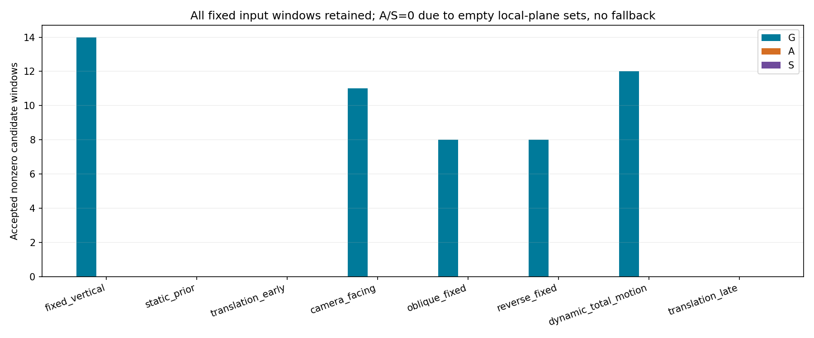
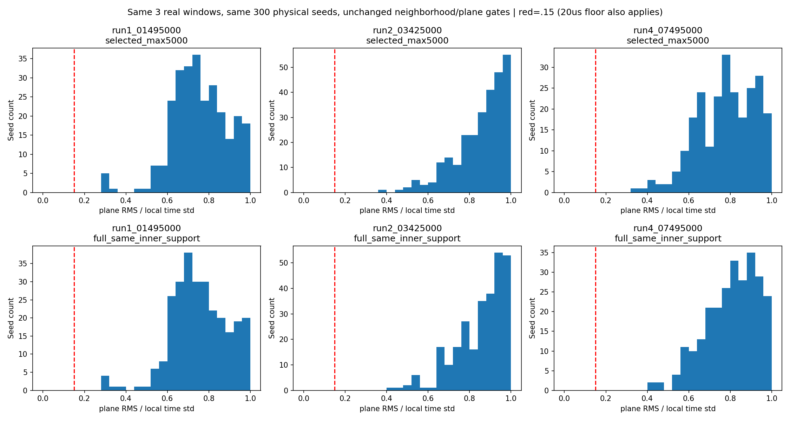
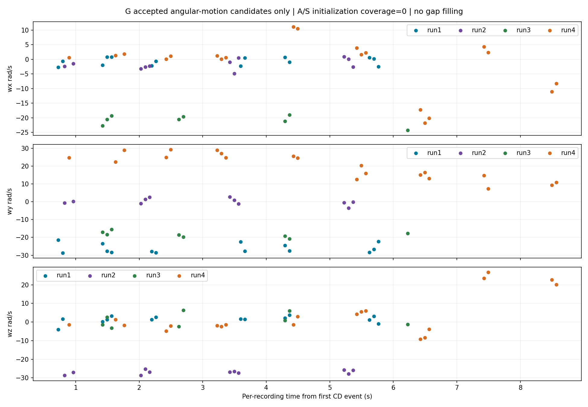
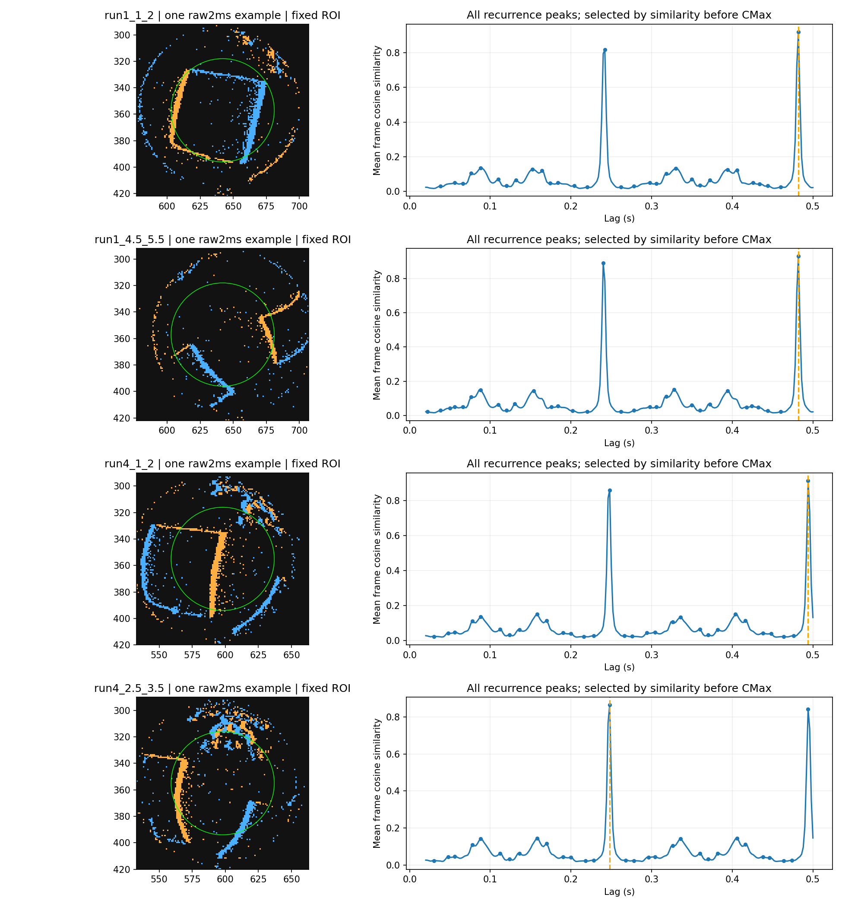

# 阶段3最终实验：G/A/S固定范围对照及独立纹理周期检查

**固定108唯一窗×G/A/S的324条状态、4次周期检查和必要解析核验均已完成；实验到此停止。** G保留53个非零候选；A/S在本轮实录输入上均无可用初始化，未运行实录搜索、未回退G。数据支持G的固定方向和正反转定性行为，但**不支持宣称完整Sony实录流程已打通、复现论文精度或A/S带来实录提速**。所有旋转输出仍为`hypothesis_only=true, physics_validated=false`，B1继续作为暂定几何基线，生产默认未改。

本阶段方案由GPT-6 Astra（xhigh）审阅，GPT-6.1 Sol（high）执行；完成后的结果与hash交Astra终审。全部5段完整RAW和官方解码已在本地使用，无需SSH。本实验没有外部球心、三维轴或RPM真值，没有训练CNN、硬件GCS、在线或实时性能验收。

## 固定输入、冻结与失败口径

- 原阶段1的48窗、阶段2的36扩展窗，加run4动态15窗和run5后部9窗，共108；阶段2的8个速度消融窗不另增加。统一B1，各路线同事件ID/时间/顺序/极性/半径/球面输入，按来源保持原掩膜及≤5000次采样。阶段1两个过拒窗用阶段2修复输入，显式记录来源，不改旧报告和分母。
- 新8块先看原始1ms/5ms图，冻结seed/r/杆排除扇区，再提取几何并审阅，不参考旋转得分。run4各块r=65/63/61/80/77px，排除扇区30–90/45–105/116–176/60–120/65–125°；run5三块r60、60–120°。这些是原始图量级的候选，不是标定半径。
- 沿用阶段2薄环和几何支点门限，新增run4有14/15窗几何支持，run5有5/9；5个新缺失原样保留。总计88窗有几何（其中12个静止窗只有人工位置先验），20窗几何失败；76窗达到原最低100事件要求。
- [协议](protocol.md)、[配置](config.json)、[原始先验审阅](geometry_prior_review.json)、[最终几何审阅](geometry_final_review.json)、解析测试及独立周期峰均在本阶段旋转求解前进入[freeze.json](freeze.json)。旧阶段1/2、生产、RAW/解码324项受保护文件hash前后未变。

逐窗来源及失败见[window_audit.json](window_audit.json)。阶段1非静止原交集44.4px、阶段2 B1/B2交集0.8r、新增B1内区0.8r并不相同，因此提供run/条件/来源/开发评价分层统计，不能把跨来源差异当方法效应，也不能把采样可用率当整段录像覆盖率。

## 三路线及数学边界

依据[论文v2的3.3节](https://arxiv.org/html/2606.26780v2#S3.SS3)，A实现文字描述下的二维normal-flow切向lift、三维欧氏P投影最小二乘、沿有向初轴的幅值扫描和单次三维Nelder–Mead；S将初始化公式换为现有标量图像法向约束，后续与A相同。G直接调用原冻结网格多初值NM。A/S没有调用`estimate(initial=...)`冒充路线，也没有用标签补轴或翻转初轴。

|项目|本轮实现与解释|
|---|---|
|论文文字路线|orthographic单位球、切向速度、方向投影P、LS、幅值搜索、NM；可构造成明确可运行解释|
|A|`f=g/(g·g)`；`v=(fx/r,fy/r,−(xfx+yfy)/(r*z))`；`P=vvᵀ/(vᵀv)`；stack `P*(−[s]cross)`和`P*v`|
|S|`r*(s×[a,b,0])·omega=1`；只作公式初始化消融；原标量0.35残差门限另列native状态|
|未公开而由工程冻结的选择|4px/±2ms、最多300seed、邻居/平面残差/条件数筛选，3500RPM上界、离散扫描数量、64×128 IWE、G多初值、工程质量门限等；不能声称与未公开官方实现完全一致|

A/S共用同一份落盘planes，使用同最多5000输入事件，不从完整数据补邻域。共同初始化条件仅≥12planes、rank3、condition≤100、有限非零方向；未另加按结果选择的残差门限。S的native残差状态单独保存，不冒充原接口全部门限已经通过。

A与S一般不等价。[原7组数学测试](math_verification.json)保留了固定反例：单点标量约束为1，A中`P@truev−liftv`范数0.245973675；六点满秩例S回收(1,2,3)，A为(1.10926831,1.81278968,3.75706699)，若P使用真实完整切向速度则回收(1,2,3)。球面lift的`JᵀJ≠I`解释了二维法向约束与此三维欧氏方向投影解释的差异。**这只限定本轮对论文文字的解释，不能据此说未公开Sony实现错误。** P对称/幂等、球面微分、单位/符号及退化均通过。

搜索保留显式zero分数，zero可胜出；拒绝时measurement字段为null，原NM输出保存在`search.optimizer_candidate_*`，并另导出[optimizer_candidates.csv](optimizer_candidates.csv)，没有被zero诊断覆盖。G原生状态与共同质量分别报告；G的多初值竞争检查保留，A/S标记未执行，不能据此宣传更高原生通过率。相关工程门限不提供统计置信度。

## 324条实录状态：A/S都在平面支撑阶段失败

|条件|预定窗|有几何|事件可计算|G有效非零候选|A/S可用初始化|A/S实录搜索|
|---|---:|---:|---:|---:|---:|---:|
|run1 固定竖直|18|14|14|14|0 / 0|0 / 0|
|run2 朝相机|12|12|12|11|0 / 0|0 / 0|
|run3 固定斜杆|12|8|8|8|0 / 0|0 / 0|
|run4 反转固定前段|12|8|8|8|0 / 0|0 / 0|
|run4 动态总角运动|15|14|14|12|0 / 0|0 / 0|
|run5 静止先验|12|12|0|0|0 / 0|0 / 0|
|run5 前部平移|18|15|15|0|0 / 0|0 / 0|
|run5 后部平移|9|5|5|0|0 / 0|0 / 0|
|合计|108|88|76|53|0 / 0|0 / 0|

G另有23窗`no_rotation_evidence`、12窗事件不足、20窗几何失败；本轮G原生与共同非零质量均为53，仍分别存储。A/S各76窗`insufficient_flow_constraints`、12窗事件不足、20窗几何失败。88个落盘plane集合均为空，A/S实录轴、RPM、搜索收敛改善和相互差异**不可识别**，不是估计到零。

### 全零plane结果的独立交叉核查

76个事件可计算窗共检查22,633个seed：17,063个因平面残差/秩退出，5,570个邻居不足；静止12窗在事件数前置检查退出，没有伪造seed。65个可计算窗原来就没有下采样，只有11个下采样，因此不能简单归因5000截断。

三个代表窗用原frozen `optical_flow.estimate_flow`、正确int64微秒schema转秒直接重放，均同样0接受；每个窗再以相同300个物理seed，在原5000输入与完整同内区事件上比较，参数保持4px/±2ms和原平面门限：

|代表窗|选中→完整内区事件|选中邻居中位→完整|选中RMS/std中位→完整|两者接受平面|
|---|---:|---:|---:|---:|
|run1 1.495s|5000→5460|49→55|0.751→0.747|0→0|
|run2 3.425s|5000→5582|37→42|0.885→0.892|0→0|
|run4 7.495s|5000→9256|22→41|0.787→0.825|0→0|

门限为RMS≤max(20us,0.15×local-time-std)，不是无条件0.15比值。1800行完整逐seed邻居数、二维支持比、时间std、残差、门限与退出原因见[plane_seed_diagnostics.csv](plane_seed_diagnostics.csv)，接口及完整内区结果见[plane_sampling_diagnostic.json](plane_sampling_diagnostic.json)。诊断单列，不替换324主比较，也没有放宽门限再试。

Astra还独立用整数us差、像素距离平方、同极性直接筛选及居中协方差正规方程审计未下采样的run2 2.095s（2809事件），避开本轮extract/cKDTree/lstsq：250个有空间支撑邻域均不过门限，RMS/std最小/中位约0.2312/0.9074，最小RMS232us，另外50个邻居不足。[reviewer_flow_audit.json](reviewer_flow_audit.json)明确标为审阅者提供的独立证据，不伪称执行者自己重跑。

结论限于：**冻结的局部时间平面模型和筛选在这些实录输入上没有给出可用流。** 现有诊断不能唯一分离场景边缘模型、事件时空分布、采样和噪声的影响，不说明G1硬件不支持，也不说明论文或Sony未公开实现失败。

### 必要成功分支只在解析数据核验

[提取正例fixture](extraction_positive_fixture.json)为169个精确时空平面事件，接受169个planes，回收g=(1e−4,1.5e−4)s/px，最大梯度差1.98e−18、RMS2.85e−18s。单法向使S秩2；A虽秩3但条件数约595，二者初始化均按原门限拒绝。这个fixture验证extract成功分支，未要求单法向恢复完整spin。

[解析搜索桥接测试](analytic_search_verification.json)用确定性理想球面坐标轨迹实际执行A/S搜索：逐点独立重建LS，验证扫描含zero且只沿给定有向初轴，包裹真正`methods.minimize`实计每种恰1次NM，G调用哨兵确认无G调用。所有扫描及最终IWE用独立SciPy Rotation、bilinear直方图和高斯平滑重算，扫描分数最大差2.12e−22。另测zero胜出时measurement为空且原优化候选未被覆盖。

这些测试证明相应代码路径可执行，**不是DVS物理仿真，不是实录A/S通过，也不证明忠实官方实现或论文精度复现**。没有把它们算进324条真实输入状态。

## G的行为证据与边界

固定候选RPM中位：run1约264.7，run2约258.0，run3约271.9，run4固定前段约250.7；没有转速计验证。run2有效轴`|z|`中位0.9944，定性支持朝向相机；run3外杆二维投影差8窗中位5.47°、最大10.94°，但`|z|`中位仅0.0886，没有验证用户“斜向相机”的真实深度倾角。

run4固定前段八个有效wy全部为正，而本阶段run1十四个固定有效wy全部为负；相对这十四窗平均有向轴的夹角中位178.22°，范围171.50–179.35°，支持正反转定性关系，不要求RPM相同。该均值包含两个恢复窗，所以与阶段2旧12窗参考的数字不同。run4固定前段5窗有外杆线支持，二维投影差中位2.19°，不是三维轴误差。

动态run4 14个有几何输入中12个被G接受，候选RPM中位246.0；另2窗原门限拒绝。动态轴随姿态改变，结果是装置手持角运动与电钻自转叠加的总角运动假设，不能分离为纯电钻spin。六个具有支持的二维外杆投影诊断中位差2.81°，仍不能验证深度或总角速度物理准确性。

run5前/后平移共20个事件可计算窗G均返回`no_rotation_evidence`，静止12窗全部事件不足；没有把这些状态填成零RPM。A/S在这些负例同样没有可用planes，**其0个有效输出不能被解释为误报改善或测准零**。

[固定及动态投影明细](shaft_projection.json)、[方向与反转检查](direction_checks.json)，新增全部原始10ms叠图：[run4动态15窗](run4_new_windows.png)、[run5后部9窗](run5_new_windows.png)。不对旋转插值，不以高IWE、低轴离散或投影吻合当作绝对准确证明。

## 四次独立纹理周期检查

最初考虑B1逐帧中心对齐，但在运行周期和本阶段CMax之前，发现阶段2 run4几何只覆盖四个块附近，不能为指定1秒区间连续对齐；因此一次改为原QC位置的固定ROI先验，随后才计算周期，并把原始峰文件hash与方法一起冻结。详见[选择时序](periodicity_method_note.md)，没有看CMax后重跑或择峰。

使用2ms极性分离事件帧、内0.65r、4px格点、每帧L2归一化及20–500ms余弦相似lag，保留所有局部峰和半/倍周期关系。固定ROI没有消除漂移或振动，相似度也会受纹理对称和活动模式影响。

|区间|最高相似主峰/相似度|次强复现峰/相似度|同区间G有效窗|
|---|---:|---:|---:|
|run1 [1,2]s|0.482s / 0.920|0.242s / 0.817|3|
|run1 [4.5,5.5]s|0.482s / 0.929|0.240s / 0.889|0；不追加求解|
|run4 [1,2]s|0.494s / 0.915|0.248s / 0.862|2|
|run4 [2.5,3.5]s|0.248s / 0.864|0.494s / 0.842|3|

最高峰照原选择保留。若机械地按一复现一圈解释，前三个主峰约124.5/124.5/121.5RPM，存在明显倍周期候选；第四个约241.9RPM。不能为了接近G改选前三者的一半。全部峰、比较区间和G候选分布见[periodicity_comparison.json](periodicity_comparison.json)。这支持原始事件有约0.24–0.25s和其倍周期的纹理复现结构，**不提供独立RPM精度验证**；第二区间没有固定G窗，不能做同区间比较。

## 成本、核验与交付

计时采用相同输入，G包含球面准备+搜索，A/S包含球面准备+实际测得的共享plane提取时间+各自LS+搜索；共享提取虽然只执行一次，其实测时间分别计入A/S完整计算链，未用缓存0耗时。几何检测、归档IO和离线报告另行排除，不能称端到端在线性能。

G在各类可计算输入的计算链中位耗时约0.21–0.84s。A/S失败链约0.005–0.015s，全部提前退出，**不能称为成功初始化的提速、吞吐收益或替代G的更快spin估计**；成功A/S实录流水线成本不可识别。完整计时、NM/目标调用数和候选扫描均保留。

[verification.json](verification.json)通过：108窗/324状态完整；88个实际输入与原档ID/像素/极性/时间一致，三法输入及球面hash相同，独立重建负z单位球最大差0；A/S共用planes且失败无搜索/回退；76个真实G候选目标用独立旋转/直方图重算；一个G去包装字典完全一致；324项旧来源文件hash未变。原7组解析测试、额外A/S搜索桥接、extract正例以及原接口/完整邻域诊断分别留有文件，未伪称实录A/S优化已核验成功。

交付入口：[完整324状态与搜索细节JSONL](results.jsonl)、[CSV](results.csv)、[初始化诊断](flow_diagnosis.json)、[按run](summary_run.json)、[按条件](summary_condition.json)、[按几何来源](summary_geometry_source.json)、[按开发评价](summary_partition.json)、[原优化候选CSV](optimizer_candidates.csv)、[来源hash](source_hashes.json)。`windows/`、`spheres/`、`planes/`分别保存88个有几何窗口的像素输入、实际球面输入及共享planes；空plane集合也落盘，缺失几何只保留状态。

可运行顺序：已有venv执行`scout.py`，按原始图记录配置/审阅；`geometry.py geometry`、`geometry.py prepare`、`test_math.py`、`periodicity.py`、`geometry.py freeze`、`run.py`、`verify.py`、`plane_sampling_diagnostic.py`、`summarize.py`。关键原始输出拒绝覆盖；要重放必须建立独立输出目录，不能覆盖本轮。

## 最终判断

- **支持**：冻结G+B1在固定方向、朝相机定性分量、外杆二维关系和正反转上的行为证据；平移样本中应拒绝有把握非零输出；原始纹理有清晰复现及半/倍周期歧义。
- **不支持**：以本轮冻结local-plane前端打通实录A/S初始化；以0输出当负例性能改善；以解析代码可执行当忠实官方复现、论文精度复现或实录速度优势。
- **不可识别**：真实绝对三维轴/RPM精度、run3深度倾角、零速置信界、动态纯电钻与手持角运动分离、成功A/S实录搜索差异/成本、在线性能。

既定108窗、324状态、4次周期尝试与必要核验至此结束。没有因结果不好追加窗口、改邻域/门限、反复调几何或自动开启后续实验。
