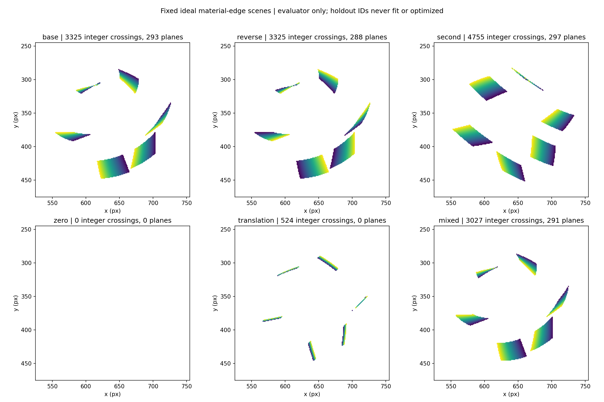

# 阶段4 task1+3检查点：整数事件全链正例与A语义

**同一组整数几何crossing事件已经贯通事件→local planes→满秩LS→初始化→有向幅值搜索→实际一次NM。** 三个旋转正例的S均通过预定合成门槛；A_literal三例也均实际执行搜索，没有G回退。task3的raw平移右端、坐标先补偿再提取及切向协向量语义核验完成。当前只证明冻结接口在干净几何边缘模型可贯通；**本检查点尚未改变或运行任何实录前端，不证明实录A/S已通过，也不证明Sony官方复现精度**。

方案由GPT-6 Astra xhigh审阅，GPT-6.1 Sol high执行；本检查点完成后交Astra决定下一步实录前端。阶段3算法、原工程门限、旧结果和RAW未修改。这里的“真值”仅指生成器给定合成参数，不能外推实录绝对误差。

## 同事件与真值隔离

半径120px，中心(640,360)，10ms，参考5ms；6条局部材料大圆弧按预定锚点、image normals及lift Jacobian构造，每条只保留±0.14rad材料弧。生成器独立用SciPy Rotation和25us扫描/brentq求整数像素的过边缘时刻；输出整数x/y、四舍五入us和跨越极性，未调用任何估计器。固定omega为(10,20,30)、反向、(−20,30,10)，另有静止、纯平移和旋转+平移。

根残差独立复算最大8.19e−14，时间四舍五入误差≤0.5us，全部弧/可见负z和解析极性导数一致。它没有模拟传感器对比阈值、噪声、不应期、照明或包丢失，是理想几何边缘crossing。

`inputs/`只含events与几何；omega/材料edgeID和精确根只存在`truth/`，由独立evaluator读取。runner不导入生成器/evaluator、不打开truth。生成配置、脚本、算法副本和events在求估计前进入[synthetic_freeze.json](synthetic_freeze.json)。固定按`(x+2y)%5==0`留出约20%原始事件，其余才用于提取和搜索。这个holdout规则也在运行前冻结；没有根据omega或输出选择事件。

三路线各场景共享训练ID、时间、顺序、极性、半径和球面。A_literal/S共用同一planes；G只是独立参考。所有case低于5000训练事件，不触发下采样。没有trueinit、按truth给前端分edge、G回退或降门限。另以完整events提取作支撑诊断，但没有替换训练输入。

## 三个预定S完整正例

|场景|总/训练/holdout事件|planes / 物理edge（仅eval）|S rank / condition|S初轴误差|S初speed相对误差|S最终轴误差|S最终speed相对误差|
|---|---:|---:|---:|---:|---:|---:|---:|
|base (10,20,30)|3325 / 2655 / 670|293 / 6|3 / 2.02|0.067°|+0.110%|0.682°|+0.668%|
|reverse|3325 / 2655 / 670|288 / 6|3 / 2.03|0.123°|−0.130%|0.719°|+0.697%|
|second (−20,30,10)|4755 / 3809 / 946|297 / 5|3 / 1.93|0.024°|−0.052%|0.120°|−0.028%|

三例都满足初始化≤10°/≤15%、最终≤5°/≤10%的预定合成门槛，有向反转符号正确。second的第4条材料edge没有可用planes，仍保留其70个原始事件和对应holdout；5个独立物理edge已给满秩，不补edge或改参数。

**S三个初始轴均比NM后的轴更接近合成参数。** 因此不能笼统说CMax细化提高精度。其IWE分数确实上升，但这个离散/平滑目标与有限像素事件的真值误差并不等价，比较见[refinement_score_comparison.json](refinement_score_comparison.json)。S仍通过门槛仅表示本次整条实现路径通过了预定测试。

|场景|A_literal初轴误差 / speed差|A_literal最终轴误差 / speed差|G最终轴误差 / speed差|
|---|---:|---:|---:|
|base|3.817° / +9.165%|0.710° / +0.668%|0.711° / +0.697%|
|reverse|3.336° / +7.381%|0.728° / +0.665%|0.685° / +0.671%|
|second|6.964° / −0.337%|0.104° / −0.002%|0.088° / −0.024%|

A_literal在本例中初值到最终的误差有所下降，与S的变化不同。它仍按阶段3原解释执行，不因为误差与S不同就替换公式。A/S每次实际包裹`methods.minimize`计数均为1，G调用哨兵确认没有回退；搜索包含zero、沿原有向初轴正幅值扫描，无标签翻轴。完整扫描、NM候选、zero分数、初始化LS、最终measurement/拒绝分离见[synthetic_results.json](synthetic_results.json)，数值表见[synthetic_metrics.csv](synthetic_metrics.csv)。

## 留出运动一致性与跨edge共同omega

训练plane邻域不含任何holdout事件，也没有把物理edge标签送入前端。求解后evaluator根据truth edgeID检查物理支撑，所有接受planes邻域均来自单条材料edge（purity=1）。

留出原始事件对训练局部时间平面的RMS中位，base/reverse/second分别约4.50/4.26/4.48us；P95约75.8/73.5/11.3us，base/reverse尾部局部平面误差明显更大，未隐藏或据此换plane。所有行与原训练残差尺度见[heldout_local_motion.csv](heldout_local_motion.csv)。这是独立事件预测诊断，并非只数planes。

用各路线最终omega将训练和holdout事件分别去旋转，仅从每条edge的训练事件拟合材料大圆法向，再评价该法向对同edge未拟合holdout的残差。S三个正例每edge残差中位最大约0.118/0.123/0.020px；这些holdout既未参与LS也未参与IWE优化。完整每edge及zero-motion基线见[synthetic_evaluation.json](synthetic_evaluation.json)。

进一步由evaluator每次移除一个物理edge的全部planes，仅以其他edges求同一个S omega，再预测被移除edge的aperture约束：base/reverse/second最大留edge-out RMS为0.0278/0.0372/0.00231，最大有向轴误差约0.208°/0.128°/0.048°。该分组是生成器truth支撑下的合成评价，不能直接当成未来实录edge分割方法。明细见[leave_one_edge_out.csv](leave_one_edge_out.csv)。

## 零、退化及平移控制

- 同纹理零旋转生成0事件，A_literal/S无初始化，G事件不足；不能称准确测得零。
- 旧169单法向fixture仍接受169个planes，但S秩2、A_literal条件数约595，均拒绝初始化；[退化控制](rank_degeneracy_control.json)没有强求单法向spin成功。
- 纯平移生成524事件，训练425；raw提取108个planes，正确RHS修正后得到小残余初始化向量范数约0.0176rad/s，只作为量化误差诊断。先将全部events减去给定中心轨迹再重提取，得到0个planes；G返回无旋转证据。两路径没有被强行变成同样的“有效零measurement”。
- base+平移生成3027事件，训练2412；统一去平移后提取291个planes。S初轴误差0.0188°、speed差+0.0268%，最终0.5008°/+0.3670%。raw梯度修RHS的S初值与补偿后重提取S初值向量差约0.0167rad/s，raw路径初轴误差和完整数据见评价JSON。A_literal仅在先统一去平移的events上运行，未用`f_normal−cdot`虚构完整flow。

raw plane路径以空间质心及其拟合质心时间定位真实给定中心，约束为`r(s×[a,b,0])·omega=1−gᵀcdot`；统一坐标补偿路径重新提取邻域和平面，所以有限事件下可近似相符，不要求逐plane一一相等。给定几何速度是合成输入，不是从实录估计到的真值。

## task3语义结论

[semantics.md](semantics.md)记录一次有限来源核查及完整推导。主文规定流程但没有g到三维normal velocity的细式；官方公开pseudo code包含最近时间戳的时间表面/CNN/CMax，没有offline OF/P；Nature可得补充不提供这个歧义所需推导，Astra对v2 PDF的审阅亦未获得被引用Appendix A。本轮不能把官方在线时间表面说成官方offline规定，更不能宣称Sony未公开实现错误。

A_literal保留`v=Jg/(r*gᵀg)`及其非等价反例；解析对照使用h=(I−ssᵀ)r[gx,gy,0]、b_rhs=1−gᵀcdot，最小范数切向速度为b_rhs*h/(hᵀh)，P=h hᵀ/(hᵀh)。逐条对应S，但直接stack该投影LS隐含1/||h||权重，不能说整体未加权LS相同；b_rhs=0也保持非零h/P，不除b_rhs。[7组语义验证](semantic_verification.json)均通过，未新增第4实录算法。

## 验证、范围及下一检查点

[verification_task13.json](verification_task13.json)核对：原阶段3 manifest的422项及其324项来源未变；本阶段冻结脚本/events与hash一致；同整数事件的accepted planes用独立正规方程重建，A_literal/S LS逐点独立重建；完整负z单位球、holdout隔离、root/弧/极性/单位、每个扫描和最终IWE独立Rotation+直方图复算均通过。所有真实实录前端仍未运行，没有因合成成功改变108窗旧回归结果。

本阶段只补齐了之前缺失的同events全链正例，并明确A_literal的解释与平移约束边界。理想干净模型通过不能解释实录此前为何0plane，更不能替代实录留出运动一致性/跨独立边缘共同omega/负例验证。task1+3至此交Astra检查点审核，再依独立下发协议进入task2；不自行增加scene、改门限或扩窗。

重放入口：现有venv依次执行`generate.py`、`run_synthetic.py`、`semantic_tests.py`、`evaluate.py`、`verify_task13.py`；关键生成/估计输出拒绝覆盖。生成器和runner分离，truth只允许evaluator读取。后续上传仅保留代码、这些小型合成输入/结果和审阅证据，不上传完整RAW或超大文件。
