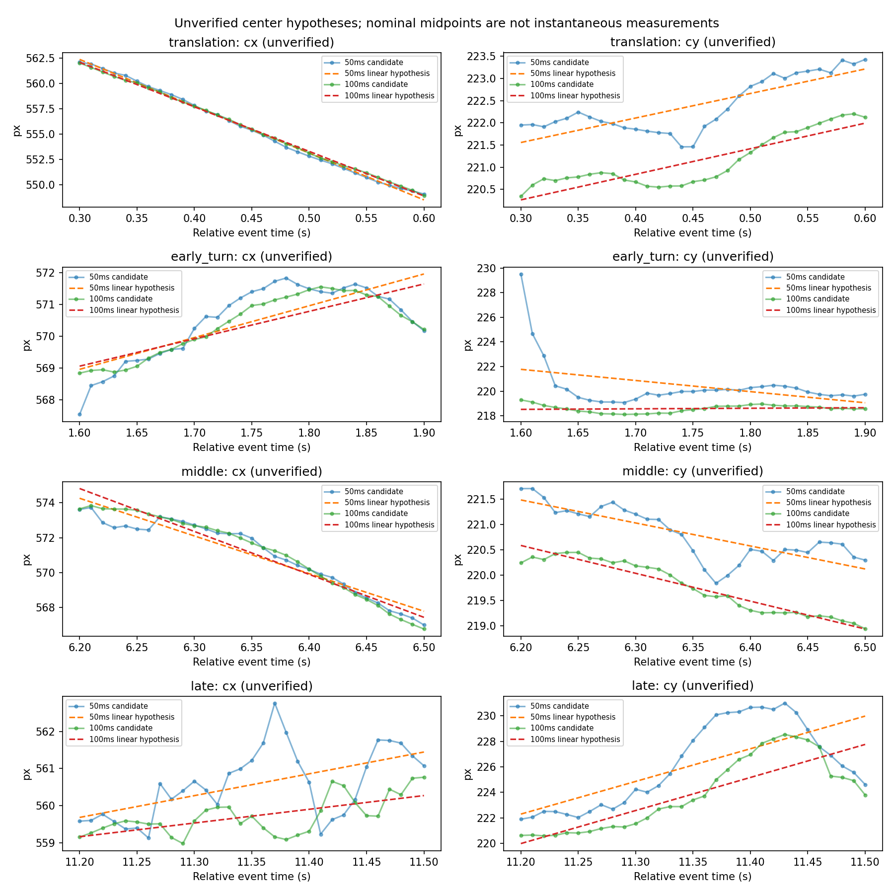
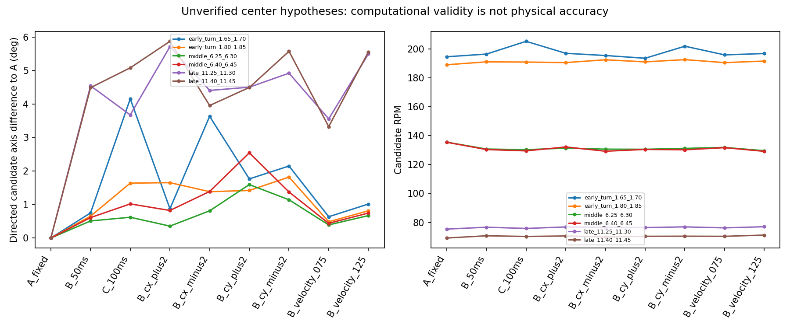

# 现有实录：未验证球心假设下的 s-CMax 敏感性

2026-11-02。**现有录像可支持同事件、固定/动态/扰动球心假设之间的计算对照，仍不能确认真实平移补偿收益或角速度精度。** 本轮按预声明协议完成6个50ms非重叠窗×9种假设=54次优化；全部通过现有数值/质量gate，未发生优化失败，但所有真实结果均为 `hypothesis_only=true, physics_validated=false`。较小扰动下没有出现多数候选大幅跳轴；这只是被选内区事件上的有限局部稳定性，不是球心或转轴真值验证。

## 已冻结的方法与球心证据

完整定义在 [protocol.md](protocol.md)。只读10/29官方SDK已解码的6,020,744条事件及既有几何表，不重新提取轮廓、不调阈值、不根据旋转分数挑中心。固定r48、固定0.6 count阈值，分别用50/100ms候选在每个预定0.30s片段的31个名义中点上拟合一阶cx(t),cy(t)。名义中点不是瞬时测量；一阶曲线仅是短段假设，未强加0.46Hz或其他周期。全部事件和t_ref均在候选名义中点端点覆盖范围内，无外推。

下表在运行旋转优化前产生；跨度/残差含真实运动、外包络变化、取点污染和模型失配，不等于像素误差或真值置信区间。50–100ms的两组曲线来自同源事件且高度重叠，不能当独立重复测量。

|片段|50ms原候选cx/cy跨度 px|50/100ms一阶残差RMS px|50–100ms候选距离中位/最大 px|50ms曲线预测窗内50ms位移 px|
|---|---:|---:|---:|---:|
|平移0.30–0.60|13.01 / 1.97|0.42 / 0.30|1.30 / 1.61|2.33|
|早1.60–1.90|4.30 / 10.44|1.94 / 0.61|1.44 / 10.31|0.68|
|中6.20–6.50|6.71 / 1.87|0.67 / 0.51|1.22 / 1.55|1.10|
|晚11.20–11.50|3.63 / 9.10|2.41 / 1.55|2.08 / 6.24|1.31|

早段50ms固定阈值在1.60s附近cy明显偏离后续候选，一阶最大残差7.87px；未剔除或修正该点。它影响段内速度假设，是本次结果的重要输入限制。晚段两时长均明显非线性/不稳定，继续保留旧报告的“不通过无条件几何出口”判断；本次数值优化通过不能推翻该判断。中段曲线相对平滑，也没有独立准确性证据。平移段仅作几何诊断，没有旋转调用。

原有几何/边界报告已显示：r46→50时代表窗cy可变化约4.7–6.1px；删除45°区域时fixed48中心最大变化早0.61、中0.79、晚4.92px（旧主scaled阈值诊断，并非本轮fixed阈值重测）。上弧cy/r耦合、球形凸起Marker可能参与外侧点、下部遮挡、真实silhouette身份均未解决。fixed48只是先验，不能把其曲线平滑解释为精度提升。本轮±2px扰动也不覆盖这些全部误差来源。



A固定在各窗B(t_ref)；B为50ms候选线性轨迹；C为100ms候选线性轨迹。其余6个variant为B的cx±2、cy±2px、速度×0.75/1.25。速度扰动固定同窗B(t_ref)，只改窗内斜率；C同时可能改变offset与斜率。所有方法采用窗几何中点t_ref。恒定球心offset在u'=u−c(t)+c(t_ref)中抵消，随后球面lift仍须减去c(t_ref)，因此球面输入仍受offset影响，不能用对齐图相同证明中心正确。

仅调用旧translation.py的`centers_at`数学层，未构造“真实中心/同步已校验”元信息，也未绕过验证输入契约调用compensate。相对首CD事件微秒用于同源候选记时，这只是相同录像内的名义时间，不是独立同步证明。

## 共同事件与优化结果

mask在优化前一次性固定：原始ROI [475,638)×[143,285)、原始y<240、九种假设的逐事件距离均≤0.8r。记录每种假设mask前球外数，未夹回球面。每窗先取共同ID，再一次确定性linspace下采样至最多5000条；九种方法共享同ID、顺序、时间、极性。这个共同内缩mask主动丢掉了困难边缘；结论只覆盖所保留内区事件。y<240只是既有遮挡关注mask，不能保证去掉所有遮挡边缘或内部Marker事件。

|窗 s|原始总数|ROI数|共同保留|占ROI|实际优化数|
|---|---:|---:|---:|---:|---:|
|1.65–1.70|15389|7365|4533|61.55%|4533|
|1.80–1.85|18744|11026|6456|58.55%|5000|
|6.25–6.30|17969|7490|4520|60.35%|4520|
|6.40–6.45|19747|9131|5184|56.77%|5000|
|11.25–11.30|15487|4552|2525|55.47%|2525|
|11.40–11.45|15497|4008|1944|48.50%|1944|

使用未改动的`spherical_cmax.estimate(max_rpm=600, initial=None)`，同一工程格点多初值策略，不灌入周期法或已知转速/转轴。600rpm只是搜索上界。下表角度为B相对A的有向夹角，RPM为优化器返回候选；无真实角速度误差含义。contrast比较同一事件ID下旋转后IWE方差，B/A百分比不是精度指标。

|窗 s|A/B/C候选 RPM|B−A RPM|B对A有向轴差 °|B/A contrast变化|六种B扰动对B最大轴差 °|
|---|---:|---:|---:|---:|---:|
|1.65–1.70|194.51 / 196.35 / 205.18|+1.84|0.750|+0.008%|2.934|
|1.80–1.85|188.99 / 190.98 / 190.85|+1.99|0.653|+0.092%|1.666|
|6.25–6.30|135.48 / 130.73 / 130.28|−4.75|0.510|−0.162%|1.324|
|6.40–6.45|135.41 / 130.37 / 129.46|−5.03|0.610|−0.115%|2.249|
|11.25–11.30|75.40 / 76.68 / 75.83|+1.28|4.543|+0.075%|2.973|
|11.40–11.45|69.22 / 70.77 / 70.31|+1.54|4.488|+0.136%|2.149|

54/54计算有效、0次失败、0次搜索边界拒绝，完整返回质量信息/分量/差值均保留，不能把valid解释成物理有效。六窗B相对A的contrast仅−0.162%至+0.136%，没有一致收益。晚段有约4.5°方法差但其球心输入最不可信；不能把差值方向称为校正成功。早首窗C相对B有向轴差4.630°、转速差+8.83rpm、contrast约低11.2%；同源窗口假设差足以超过固定/动态之差，不能以最高contrast挑真实球心。恒定offset扰动还可使contrast变化约−8.8%至+9.3%（相对B），明显大于名义B/A差，进一步说明绝对中心/lift几何和坐标分箱会影响目标值。

六种轻扰动相对B最大RPM差六窗依次5.44/1.55/1.14/1.80/0.44/0.87rpm；没有出现大规模轴方向翻转。有限扰动不敏感与真实准确性不同：没有独立球心、半径、透视/畸变、真实旋转或silhouette验证，现阶段仍不能确认真实补偿收益。先前两种方法一致减速可保留为可行性证据；本轮三段候选RPM差异仍不能定量确认真实衰减或转速准确性。



[有向轴三维图](axis_directions.png)与[同事件补偿前后图](real_event_alignment.png)保留全部六窗；图中颜色是相对时间，未按观感选窗。对齐图仅展示二维平移，未显示或声称纹理被真实旋转对齐。

## 实现核验与下一次采集

对早首窗4533条真实事件人为加v=(120,−70)px/s坐标平移，再用同一个已知项消去，最大恢复误差1.17e−13px、RMS4.70e−15px；时间/极性/ID不变，未增加优化调用。它证明坐标等变实现，没有模拟真实DVS平移的触发、遮挡或反光变化，也没有提供实际球心真值。

`verify.py`不调用run.py的轨迹/取窗代码，用居中协方差闭式重新算OLS（系数最大差5.33e−13）、原始绝对时间boolean mask重新取窗、直接线性公式重建九种中心和共同mask，六窗raw/common/optimizer ID、像素、极性、时间均完全一致；用atan2(cross,dot)独立核对arccos有向夹角。run.py另断言centers_at与闭式差<1e−10px、对齐后lift与直接(u−c(t))/r差<1e−13。原始数据、生产s-CMax和三个旧实验目录文件hash前后未变。这些检查验证程序和记账，不验证物理假设。

最主要、目前可见的输入不确定性是“外侧事件拟合中心是否代表同一时刻本体几何球心”，包括累积时间包络、下部遮挡、球形凸起Marker、cy/r耦合及固定阈值下早段异常；短段线性速度也受其污染。不能给这些因素按真实误差大小排序，因没有外部真值。计算精度或同源记时并非当前已证实的主要瓶颈。

明天同步录制应优先**同时保存原始CD事件与独立可核验的本体球心轨迹**，保留原始时钟/硬件触发或可观察同步证据、时钟映射及残差；同步帧须覆盖事件窗两端，记录曝光区间/采样时刻，不能只靠文件时间。独立记录本体半径/像素尺度、相机标定与畸变处理、Marker尺寸和几何偏置，标记遮挡；若外部系统只测Marker/pivot，必须保留到球心的几何转换和误差证据。若要回答真实角速度精度，还需要独立姿态/转轴/转速参考，而非仅球心。安排静止、纯平移、纯转动及组合运动可分别检查几何/时序/旋转链路；保存全部失败窗，不能只挑高contrast片段。

复现（已有.venv，无新依赖；前两行重跑为54次优化，verify/render无优化）：

```sh
PYTHONDONTWRITEBYTECODE=1 g1_spin/.venv/bin/python g1_spin/experiments/real_center_sensitivity_20261102/run.py --prepare
PYTHONDONTWRITEBYTECODE=1 g1_spin/.venv/bin/python g1_spin/experiments/real_center_sensitivity_20261102/run.py
PYTHONDONTWRITEBYTECODE=1 g1_spin/.venv/bin/python g1_spin/experiments/real_center_sensitivity_20261102/verify.py
PYTHONDONTWRITEBYTECODE=1 g1_spin/.venv/bin/python g1_spin/experiments/real_center_sensitivity_20261102/render.py
```

优化总耗时34.50s，单次0.25–0.92s，非硬件实时保证。仅新增本目录；未联网、训练、硬件操作或生产修改。environment.json记录冻结protocol、run源码、依赖版本、旧文件与全部输入part SHA256；models.json为候选假设；geometry_diagnostics.csv、mask_audit.csv、results.csv和detailed_results.json保存完整结果；每窗NPZ保存raw/common/optimizer全局ID及实际优化事件；validation.json与independent_validation.json保存核验。交付manifest另记录本目录文件hash。
