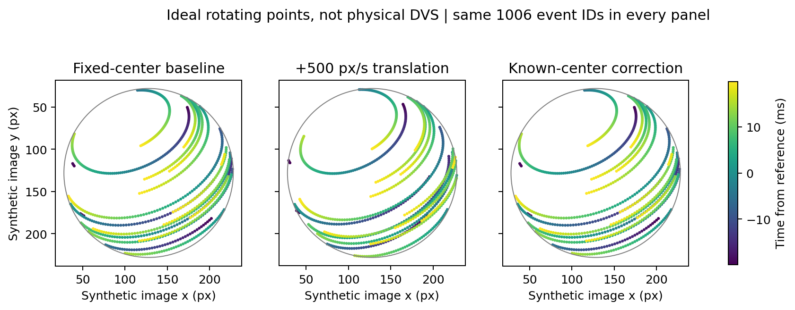

# 逐事件平移补偿 → s-CMax：受控验证

2026-11-02。已验证一个独立、可接收实际输入的二维平移补偿函数。对于已知图像平面球心，它恢复旋转事件的原始亚像素坐标，并保留原有自转；500 px/s 的受控平移经补偿后，s-CMax 与无平移基线一致。**用户已确认三段实录只有事件录像，没有同步保存球心轨迹；本轮没有运行实录补偿，也没有得到真实 G1 精度结论。**真实输入证据、后续两条路线见 [input_audit.md](input_audit.md)。

## 范围与实现

仅新增本目录文件；未修改生产模块、旧实验产物、SDK 或 RAW，未训练、连接远端或操作硬件。阅读并沿用现有 [algorithm.md](../../docs/algorithm.md) 的负 z 正交提升约定；[旧几何报告](../geometry_observation_20261101/report.md) 未验证瞬时球心，因此其圆拟合、局部 patch 锚点、周期拟合均没有作为本实验真值或输入。

[translation.py](translation.py) 实现：

```text
u_aligned(t) = u(t) - c(t) + c(t_ref)
point_xy(t) = (u_aligned(t) - c(t_ref)) / r = (u(t) - c(t)) / r
```

球心和事件坐标保留 float；半径不参与补偿、保持固定。整数微秒先用 Python 整数相减，再转换为相对浮点时间，避免 uint64 回绕与大绝对时间精度损失。线性插值要求至少两个有限球心样本、严格递增采样时间、覆盖全部事件及参考时刻；不外推。`max_gap_us` 必须显式配置，任一样本间隔超阈值即拒绝整个传入轨迹。事件可有重复时间戳，但不得倒序。超过 2^53 微秒的相对样本跨度拒绝，确保插值时间整数可精确表示。

这些措施检查接口条件，**元信息声明不是同步或球心准确性的独立认证**。函数不估计时钟偏移，不把 marker/pivot 自动转换为球心，不做 3D 投影、相机畸变、透视尺度变化或可见性建模。

## 输入契约与实际接入

中心 CSV 表头严格为 `time_us,cx_px,cy_px`。`time_us` 是非负整数微秒；其数值须与事件使用同一明确时间基。JSON 元信息字段如下，未提供任何虚构的真实轨迹模板数值：

|字段|要求|
|---|---|
|`image_plane`|固定 `G1 image plane`，与事件相同像素平面及畸变处理|
|`center_semantics`|固定 `ball_center`；来源若为 marker/pivot，须先有可靠几何转换|
|`timebase`|非空声明，明确 SDK 原始微秒或相对首 CD 微秒、原点及已有时钟映射；须与调用的 `event_timebase` 完全相同|
|`source`|非空来源与可追查记录|
|`synchronization_verified`|显式 `true`；调用者声明已有依据，函数不认证其真实性|
|`synchronization_basis`|非空同步依据；文件名时间或填表本身不构成依据|
|`center_error`|非空误差说明；没有独立误差估计时明确写未知|

可由实际 NPZ 的 `x,y,t_us` 直接调用，无需改生产入口：

```python
from translation import load_centers, compensate
sample_t, sample_xy, metadata = load_centers(center_csv, metadata_json)
aligned_xy, reference_center = compensate(
    np.column_stack((events["x"], events["y"])), events["t_us"],
    sample_t, sample_xy, reference_us=reference_us,
    metadata=metadata, event_timebase=declared_event_timebase,
    max_gap_us=chosen_max_gap_us)
# 之后使用 reference_center 和同一个固定 r 调用 spherical_cmax.lift。
# polarity、t_us、事件 ID 与排列均沿用原事件；不得量化 aligned_xy。
```

变量须来自真实且经过检查的输入；本轮这些真实条件尚未满足。本目录 `synthetic_centers_*` 明确标注为受控合成，不能用于真实录像。

## 受控协议与共同事件

使用现有 `synthetic.generate` 的理想球面点轨迹：1000 rpm，右手有向轴 `(0.309426, 0.721995, 0.618853)`；中心 `(128,128)` px、半径 100 px，持续 40 ms、3000 Hz 采样、seed=0，无额外噪声。生成器是理想几何点轨迹，**不是物理 DVS、真实商标或 Sony 数据**；自转位置由未量化采样时间生成、写出时间四舍五入为微秒。平移严格使用写出的整数事件时间叠加，故恢复一致性不依赖该微小量化差异。

平移方向为归一化 `(1,0.4)`，速度 0/100/500 px/s。以 `t_ref=19833 us` 为固定参考，轨迹为 `c0+v*(t-t_ref)`；中心采样为 0/10/20/30/40 ms，`max_gap_us=10000`。该已知中心只在受控构造中称为真值，不是从旋转目标反推的估计。

最初 1090 个事件。若直接按固定参考球心提升，三种速度分别有 0/11/84 个事件在球外。先对全部三种速度定义共同球内掩码，统一保留 1006 个事件；基线、未补偿及补偿均使用这些完全相同的事件 ID 和顺序。无传感器边界裁剪，未将球外点夹回球面；共同选择确实排除了本例最困难的 84 个事件，结论限于共同可用事件。ID 哈希见 [results.json](results.json)。

同一 `spherical_cmax.estimate`，`max_rpm=1500`，工程多轴粗搜初始化，不传真值初值或点身份；未改变优化器、IWE、质量门槛。SO(3) 检查另用已知角速度，只用于验证几何一致性，不输入估计器。

## 实测结果

轴误差为有向夹角，不对点积取绝对值；每行使用同一 1006 个事件。结果中的 `valid` 都为 true，说明质量门槛本身不能发现全部平移偏差。

|图像平移 px/s|未补偿 rpm|未补偿轴误差 °|补偿后 rpm|补偿后轴误差 °|补偿像素恢复最大误差 px|
|---:|---:|---:|---:|---:|---:|
|0（固定球心基线）|997.6539|0.24768|997.6539|0.24768|0|
|100|983.9294|0.81821|997.6539|0.24768|4.02e−14|
|500|948.9940|3.46880|997.6539|0.24768|4.02e−14|

100/500 px/s 补偿恢复 RMS 分别为 1.82e−14/1.76e−14 px。补偿后角速度三个分量与基线在此次运行中完全相同；真值 SO(3) warp 后的点与基线最大差 1.99e−15。基线本身仍有 −2.3461 rpm、0.24768°误差，补偿没有把自转消除，也没有把估计器变成真值返回器。

本机每次 s-CMax 约 0.34–0.37 s，1006 事件的中心查询与补偿约 0.26–0.28 ms；不含 CSV 读入，且不构成硬件实时保证。精确结果及运行时见 [results.csv](results.csv)、[results.json](results.json)。



## 误差敏感性：仅几何级

- 500 px/s 的球心速度低估 10%：补偿后相对原始像素最大残差 0.9917 px、RMS 0.5678 px，与保留 10% 平移的闭式结果一致。
- 匀速轨迹整体查询错开 +1 ms，事件和参考时刻同时偏移：相对位移补偿残差只有 4.02e−14 px，因为 `c(t+δ)-c(t_ref+δ)=v*(t-t_ref)`。但是错误的绝对参考中心偏了 `vδ=0.5 px`，随后减掉该中心进行球面提升的 xy 输入仍会有 0.5 px 偏差。不能用相对恢复成功证明时钟正确。
- 增加已知加速度 `(2000,-1000)` px/s²，以 100 us 中心采样并整体偏 +1 ms：仅对齐后像素的相对位移残差最大 0.04435 px、RMS 0.02539 px；与 `|t-t_ref|*|a|*δ` 的闭式结果最大差 2.47e−6 px，来自二次轨迹的线性插值。若再使用错开的绝对参考中心进入 lift，xy 输入的等价像素误差最大 0.53130 px；与独立闭式 `c(t)-c(t+δ)` 最大差 2.21e−6 px。

以上未进一步对错误中心运行优化，避免把有限样例放大成通用灵敏度曲线。真实中心误差、时钟误差、半径误差以及近球边缘提升非线性仍需单独研究。

## 验证、复现与边界

执行：

```sh
g1_spin/.venv/bin/python -m pytest -q g1_spin/experiments/translation_compensation_20261102/test_translation.py
g1_spin/.venv/bin/python g1_spin/experiments/translation_compensation_20261102/run.py
```

13 项测试通过，覆盖静止零修正、稀疏线性闭式、超过 2^63 的 uint64 时间原点平移不变、覆盖两端/gap/重复/倒序/NaN 拒绝、浮点时间拒绝、同步/球心语义声明拒绝、CSV 读入。实验脚本另断言像素恢复、SO(3) 一致、补偿后 s-CMax 与基线一致和时间误差闭式；可审阅断言位于 [run.py](run.py)。

[environment.json](environment.json) 记录源码 SHA256、合成输入哈希、Python/NumPy/SciPy/Matplotlib 版本、Git HEAD 及全部生成参数；实验新文件位于已有未提交工作区，不能仅用 HEAD 复现，需保留这些文件和哈希。没有安装新依赖。

本轮完成的是补偿数据链和几何—s-CMax 接口验证。真实平移会改变遮挡、亮度触发、事件产生率、反光、带宽和噪声，这些不由人工平移已有事件重现。真实 A/B 仍待独立检查的本体几何球心，或新的同步球心采集及必要标定；不能用本报告合成精度替代真实 G1 或 Sony 级性能证据。
