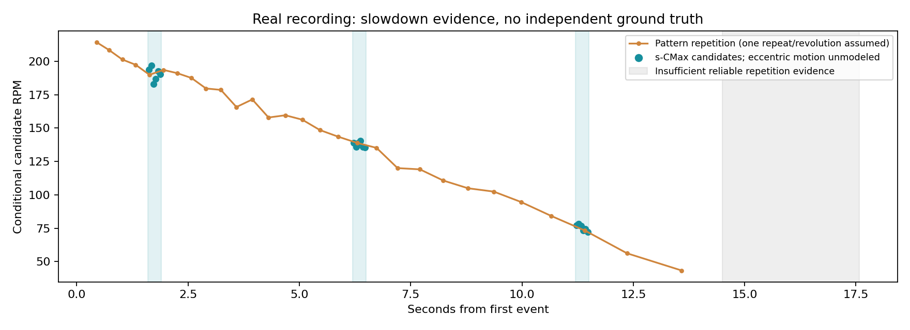

# 真实手动圆盘旋转：保存与离线分析

2026-10-29。三段RAW原件及官方SDK解码数据均已保存在Mac，RAW与所有分块SHA256匹配Ubuntu。当前无需连接Ubuntu。

## 保存清单

| 文件 | 时长 | RAW大小 | 事件数 | 筛选结论 |
|---|---:|---:|---:|---|
| DSP03F100025_20261029_221544.raw | 22.654s | 716.2MB | 186,030,505 | 留档：强背景/光照干扰，约7–8秒整体画面位置变化 |
| DSP03F100025_20261029_221756.raw | 35.689s | 180.6MB | 34,272,883 | 补充：减速可见，但仍有偏心摆动 |
| DSP03F100025_20261029_222403.raw | 17.579s | 37.9MB | 6,020,744 | 主分析：较清晰，时长适中，已选三个短片段 |

RAW路径：`../../data/raw/`。解码数据：`../../data/decoded/`。完整清单和SHA256：`../../data/archive_manifest.json`。三段均无倒序时间戳，解码器来自官方SDK1.3.0。

## 最新17.58秒录像的三个候选片段

时间均相对首事件197754251微秒，绝对时间=该值+相对秒×1e6。每段0.3秒，使用6个50ms局部窗口；各段单独采用固定ROI，内缩0.8并排除y≥240。搜索上限600RPM由手动慢转场景作工程选择，没有把周期法估计传给s-CMax作初值。

| 片段 | s-CMax候选RPM中位数 | 窗间范围 | 独立周期候选 | ROI±2px敏感性范围 |
|---|---:|---:|---:|---:|
| 1.6–1.9s | 191.5 | 183.0–197.0 | 191.2 | 173.4–193.7 |
| 6.2–6.5s | 137.5 | 135.6–140.4 | 138.4 | 132.3–145.9 |
| 11.2–11.5s | 75.5 | 72.3–78.5 | 74.1 | 72.2–81.5 |

两种方法接近，支持减速解释；它们共享同一相机数据，**不是独立转速真值**。没有强制单调拟合。周期法保留一重复=一圈假设，无法数学上排除倍频。敏感性范围不是置信区间，仅在每段中间一个50ms窗分别改变球心x/y或半径±2像素得到。



## 可靠性与限制

- 全片球心水平约539–573像素，摆动约34像素，而球半径约48像素。不能给整段套一个固定球心。
- 球下方持续截断/遮挡；轮廓拟合并非独立标定。晚段标记和轮廓事件减少，拟合更不稳定。
- 三个片段拟合球心跨度分别约2.2、5.0、10.4像素；后两者包含轮廓拟合误差，不能直接当作真实平移。短窗近似减轻但没有建模这些影响。
- 全部18个计算窗口通过优化器的启发式门限，但都标为`physics_validated=false`；数值收敛不证明物理正确。
- 三维轴候选主要朝图像+y方向（相机x向右、y向下、z远离相机），但早段轴窗间最大偏差约16°；目前不报告可信的轴精度，也不把候选向量当作已验证测量。原始omega/axis仅保留在JSON供诊断。
- 14.5秒之后重复证据不足；停止时刻和0RPM未得到可靠确认，不补零。
- ±2像素只是初步敏感性检查。晚段真实几何误差可能达到3–5像素，当前范围不覆盖全部系统误差。

## 下一次录制建议

让球心与圆盘转轴尽量同轴，减少偏心；调整视角让球面遮挡更少。保持相机固定、标记非对称。条件允许时加独立编码器或转速计，记录转速；无需为了继续本次分析重新连接Ubuntu。

## 证据与复现

- `selected/early|middle|late/`：实际5ms事件动画、ROI图、球面补偿对比、逐窗CSV和完整诊断JSON。
- `periodicity/report.md`：独立周期法、背景对照、倍频讨论。
- `qc/report.md`：球心漂移、遮挡、热点、事件数检查。
- `../older_recordings_qc/report.md`：另外两段的筛选依据。

```bash
cd /Users/vae/Projects/PingPongRobot/g1_spin
.venv/bin/python -m pytest -q
.venv/bin/python scripts/analyze_recording_222403.py
.venv/bin/python scripts/build_real_report.py
```

Mac已建立独立Python3.12环境，依赖按requirements-lock.txt安装；30项测试通过。新增的分块manifest读取不需要Mac版官方SDK，保留SDK导出的整数微秒时间戳。分析使用保存的QC圆拟合与周期结果，原始数据不改写。